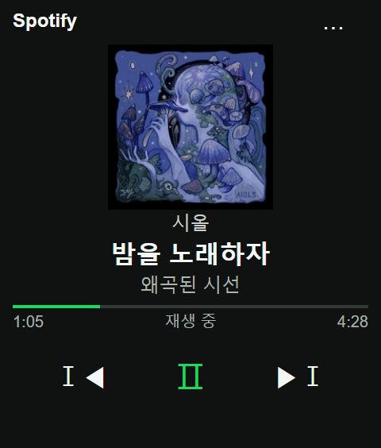
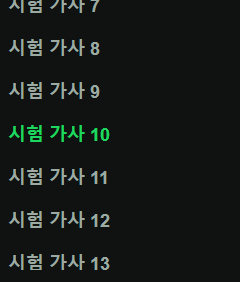
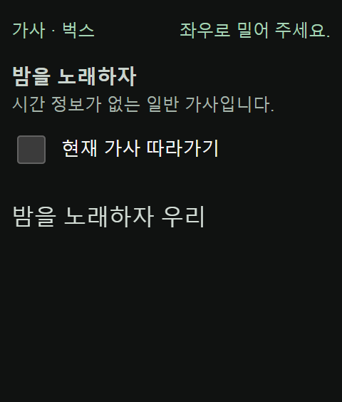

<p align="center"></p>

<p align="center"><strong>한국어</strong> · <a href="README.md">English</a></p>


<p align="center">  </p>

# R1 Spotify

**rabbit r1을 위한 손안의 Spotify 리모컨. 물리 조작부터 가사까지 한 화면에서.**

앨범아트·곡명·아티스트·앨범·재생 시간을 확인하고, 스와이프로 곡을 넘기고, 옆 버튼으로 일시정지하고, 휠로 볼륨을 바꿉니다. 별도 PC 없이 r1에서 Creation이 실행되며, 음악은 같은 Spotify 계정의 휴대폰·컴퓨터·스피커에서 계속 재생됩니다.

[시작하기](#시작하기) · [조작 가이드](#조작-가이드) · [직접 배포](#직접-배포) · [개인정보](#개인정보와-인증) · [문제 해결](#문제-해결) · [검증](#검증)

> 커뮤니티 프로젝트입니다. 재생 제어에는 Spotify Premium과 활성 재생 기기가 필요합니다. 사이트 접근 권한과 Spotify 앱 사용 권한은 각각 충족해야 하며, 현재 불특정 다수에게 제공되는 상용 서비스로 확인된 상태는 아닙니다.

## 작은 화면에 맞춘 경험

| 기능 | 제공하는 경험 |
| --- | --- |
| 물리 조작 중심 | 옆 버튼 재생·일시정지, 휠 5% 볼륨 조절, 앨범아트 스와이프 곡 전환 |
| 가사 집중 화면 | 앨범아트 탭으로 진입, 휠 탐색, 시간 정보가 있는 가사의 현재 줄 따라가기 |
| 다중 가사 출처 | 벅스 우선 → LRCLIB 정확 조회·검색 → lyrics.ovh 대체 조회 |
| 로그인 복원 | PKCE 인증, 토큰 갱신, 기기에 저장된 세션 복원 |
| 재생 상태 갱신 | 전면에서 약 3초 간격 조회, 진행 시간 보간, 요청 제한 대기 |
| 작은 표시 영역 대응 | 짧은 화면·하단 여백 처리, 기기 진단 정보 |

## 화면 미리보기

<table><tr><th>현재 재생</th><th>가사에 집중</th><th>따라가기 설정</th></tr><tr><td></td><td></td><td></td></tr></table>

240 × 282 브라우저 모의 시험 이미지입니다. 실제 Spotify 계정이나 실기 촬영 화면이 아닙니다.

## 시작하기

1. rabbit Creation에서 [기존 배포 사이트](https://r1-spotify-player-jjs1124.plutoparty.chatgpt.site/)를 엽니다. 기존 기록상 비공개 사이트로 소유자 ChatGPT 로그인이 필요했습니다. 이번 문서 작업에서 현재 공유 설정은 확인하지 않았습니다.
2. 기본 Client ID를 쓴다면 앱 소유자에게 Spotify 계정 허용 목록 등록을 요청합니다. 본인 앱을 쓰려면 [Spotify Developer Dashboard](https://developer.spotify.com/dashboard)에서 Web API 앱을 등록합니다.
3. 본인 앱에 연결 설정이 표시하는 Redirect URI를 정확히 등록합니다. 기존 사이트 주소는 다음과 같습니다.

   `https://r1-spotify-player-jjs1124.plutoparty.chatgpt.site/`

   끝의 슬래시도 포함합니다. 연결 설정에 본인의 **Client ID**를 입력합니다. Client Secret은 사용하지 않습니다.
4. Spotify에 로그인하고 재생 상태 읽기·제어 권한에 동의합니다.
5. 같은 계정의 휴대폰·컴퓨터·스피커에서 곡을 재생하면 r1에 현재 곡이 표시됩니다.

[Creation 설치 정보](docs/install-creation.json)와 [설치 QR](docs/install-qr.png)은 기존 배포 주소용입니다. 직접 배포할 때는 URL을 바꾸고 QR도 새로 생성합니다.

## 조작 가이드

| 화면 | 입력 | 동작 |
| --- | --- | --- |
| 재생 | 앨범아트 왼쪽 / 오른쪽 스와이프 | 다음 / 이전 곡 |
| 재생 | r1 옆 버튼 한 번 | 재생 / 일시정지 |
| 재생 | 휠 위 / 아래 | 지원 기기에서 볼륨 +5% / −5%, 0~100% 범위 |
| 재생 | 앨범아트 탭 | 가사 열기 |
| 가사 | 휠 또는 터치 스크롤 | 자유 탐색, 자동 따라가기 해제 |
| 가사 | 탭 또는 Enter | 설정 표시, 다시 탭하면 숨김, 3초 후 자동 숨김 |
| 가사 | ‘현재 가사 따라가기’ 체크 | 현재 줄로 즉시 이동 후 자동 추적 |
| 가사 | 좌우 스와이프 또는 Escape | 곡 변경 없이 재생 화면 복귀 |
| 메뉴 | 점 세 개 | 연결 설정·연결 해제·도움말·기기 확인 |

탭만으로 따라가기를 해제하지 않으며 체크박스 조작 시 설정 표시 시간이 다시 시작됩니다. 일반 가사는 시간 정보가 없어 따라가기가 비활성화됩니다. 세로 이동·짧은 터치·취소된 제스처는 복귀로 처리하지 않습니다. 현재 앱 인터페이스는 한국어이며 영어 README는 설치·사용 안내를 제공합니다.

## 동작 구조


브라우저가 Spotify와 직접 인증·재생 제어를 수행합니다. 같은 출처의 Worker가 UI와 벅스 가사 API를 제공하고, LRCLIB와 lyrics.ovh는 브라우저의 대체 조회 경로입니다. r1으로 오디오를 스트리밍하는 구조가 아니라 기존 Spotify 재생 기기를 제어합니다.

### 가사 조회

벅스에서는 제목·가수 별칭과 곡 길이 차이 2초 이내를 확인하고 같은 앨범을 우선합니다. 중복을 제거한 최대 세 후보를 검사하며 버전명은 유지합니다. 영어 제목을 한국어로 자동 번역하지 않습니다. 벅스는 일반 가사를 반환하고, 없거나 실패하면 LRCLIB 정확 조회·검색과 lyrics.ovh를 순서대로 사용합니다. 가사 화면을 탭하면 실제 출처를 볼 수 있습니다.

벅스 서버 조회는 전체 20초, 브라우저 대기는 25초로 제한합니다. 성공 응답은 기기에서 5분간 재사용할 수 있습니다. 제공처의 수록 범위·응답·공개 페이지 구조가 바뀌면 조회가 실패할 수 있습니다.

## 직접 배포

ES 모듈과 내장 테스트 러너를 지원하는 최신 Node.js를 사용합니다. 패키지 설치는 필요 없으며 저장소에 최소 Node 버전은 선언되어 있지 않습니다. 이번 문서 검증 환경은 Node.js 24입니다.

```powershell
git clone https://github.com/plutoparty1/Rabbit_R1.git
cd Rabbit_R1/r1-spotify
node scripts/build.mjs
```

Cloudflare Workers 등 호환되는 모듈 Worker 런타임에 `dist/server/index.js`를 진입점으로 배포하고 `bugs.mjs`·`assets.mjs`를 함께 포함합니다. 계정별 배포 설정과 자동 게시 명령은 저장소에 포함되어 있지 않습니다.

빌드는 기존 `dist` UI를 Worker에 포함하므로 화면 수정 후 다시 실행해야 합니다. `dist`만 정적 호스팅하면 `/api/lyrics/bugs`는 제공되지 않습니다.

배포 후 다음 항목을 맞춥니다.

- 본인 Spotify 앱의 Redirect URI에 새 HTTPS 주소를 정확히 등록하고 연결 설정에 본인 Client ID를 입력합니다.
- `docs/install-creation.json`과 rabbit Creation URL을 변경하고 QR을 새로 생성합니다.
- 대상 사용자의 r1에서 사이트 접근·OAuth·재생·가사·재접속을 확인합니다. 출처가 달라지면 다시 로그인해야 합니다.

### 공유와 공개 배포 조건

| 사용 방식 | 필요한 조건 |
| --- | --- |
| 기존 사이트 + 기본 Client ID | 사이트 접근 권한과 앱 소유자의 Spotify 허용 목록 등록 |
| 기존 사이트 + 본인 Client ID | 사이트 접근 권한과 본인 Spotify 앱의 기존 URL 등록 |
| 본인 사이트 + 본인 Client ID | 호환 HTTPS 호스팅·본인 앱 등록·Creation URL 갱신 |

2026-10-18 확인한 Spotify 개발자 모드 정책에 따르면 앱 소유자는 Premium이어야 하며 인증 사용자는 최대 5명이고 허용 목록 등록이 필요합니다. 등록되지 않은 계정은 로그인에 성공해도 API가 403을 반환할 수 있습니다. 더 넓은 배포에는 Spotify의 확장 할당량 승인이 필요하며, 사이트 공개만으로 제한이 해제되지는 않습니다. 최신 신청 요건은 [공식 할당량 정책](https://developer.spotify.com/documentation/web-api/concepts/quota-modes)을 확인합니다.

기본 Client ID의 실제 모드·허용 목록·잔여 자리는 소스에서 알 수 없습니다. 공개 출시 전 사이트 공유 범위, Spotify 자격 요건, 가사 제공처 이용 조건, 운영 모니터링과 실기 호환성을 확인해야 합니다. 현재 체크아웃에 라이선스 파일이 없으므로 이 README가 상업적 재배포 권한을 부여하지는 않습니다.

## 개인정보와 인증

| 데이터 | 처리 방식 |
| --- | --- |
| 접근·갱신 토큰 | rabbit 보안 저장소와 같은 출처의 기기 IndexedDB 백업에 저장; localStorage나 사이트 서버에는 저장하지 않음 |
| 진행 중 OAuth 정보 | 같은 출처 localStorage에 10분 유효 기간으로 보관; 일회용 state·PKCE 사용, 완료·연결 해제·만료 확인 시 폐기 |
| Client ID | 공개 앱 식별자로 localStorage에 저장 |
| 벅스 조회 | 제목·가수·앨범·곡 길이만 전달, Spotify 토큰 미전송 |
| 다른 가사 조회 | 해당 제공처에 곡 메타데이터 전달, Spotify 인증값 미전송 |

IndexedDB는 브라우저 저장소이며 하드웨어 암호화 저장소가 아닙니다. 보안 저장 성공 응답이 실제 저장을 보장하지 않을 수 있어 백업을 유지합니다. 보안 저장소 초기화는 제한된 시간 동안 재확인하며, 영구 저장 확인 후 로그인 유지로 안내합니다.

연결 해제 시 저장된 인증값을 지우고, 보안 저장소에 예전 토큰이 남아도 복원되지 않도록 해제 기록을 남깁니다. 브라우저 데이터 삭제·저장소 차단·Spotify 권한 취소 시 재로그인이 필요할 수 있습니다. 기기나 프로필을 넘기기 전에 연결을 해제합니다. OAuth 콜백 코드는 주소에서 제거하며 인증값을 이슈·화면 캡처·QR·로그에 넣지 않습니다.

## 문제 해결

| 증상 | 확인 사항 |
| --- | --- |
| 사이트에서 ChatGPT 로그인 요구 | 소유자에게 사이트 공유 권한 확인 또는 직접 배포 |
| OAuth Redirect 오류 | Dashboard의 HTTPS 주소와 끝 슬래시까지 일치하는지 확인 |
| 로그인 후 제어가 403 | 허용 목록·Premium·재생 기기 제한 확인 |
| 현재 곡 없음 | 같은 계정의 다른 기기에서 Spotify 재생 시작 |
| 볼륨 변화 없음 | 기기 확인에서 원격 볼륨 지원 확인; 운영체제만으로 지원 여부를 판단하지 않음 |
| 가사가 따라오지 않음 | 시간 정보가 있는 가사인지 확인 후 따라가기 체크 |
| 가사 없음 | 네트워크·제공처 장애·제목 및 버전·곡 길이 일치 여부 확인 |
| 재실행하면 로그인 해제 | 저장 진단 확인; 데이터 삭제·저장 차단·권한 취소 시 재연결 |
| 요청 제한 또는 오프라인 | 앱은 Retry-After를 따르고 마지막 정보임을 표시; 명령 연타 자제 |
| 복귀 후 오래된 화면·버튼 잘림 | 기기 확인의 버전·표시 영역과 배포 자원 확인 |

백그라운드에서는 조회를 중단합니다. 복귀 신호는 하나로 모으고 화면 크기를 재확인하며, 오래된 응답과 대기 볼륨 입력을 무효화합니다. 가능한 경우 표시된 가사와 자유 탐색 위치를 유지합니다. 실패한 다음 곡 명령을 무조건 재전송하지 않습니다.

## 개발 안내

```text
r1-spotify/
├── dist/                 HTML·CSS·브라우저 ES 모듈 (프런트엔드 원본)
├── server/               Worker 진입점과 벅스 조회
├── scripts/build.mjs     UI 포함 및 dist/server/ 생성
├── tests/                Node 테스트·Playwright 콜백 시나리오
├── docs/                 설치·화면·검증 기록·SVG
└── DESIGN.md             UI 설계 기록
```

### 검증

```powershell
node scripts/build.mjs
node --test tests/*.test.mjs
node --check dist/app.mjs
node --check dist/spotify.mjs
```

Node 테스트는 핵심 로직·OAuth·Spotify·가사 매칭·벅스·Worker 응답을 다룹니다. `tests/*-check.js`는 독립 실행 명령이 아닌 Playwright 콜백 함수입니다. `dist`를 `http://127.0.0.1:8791/`에 제공한 뒤 Playwright Page를 인수로 호출합니다. 대부분 Spotify와 가사를 모의 처리하며, `bugs-browser-check.js`는 모의 재생과 실제 벅스 조회를 사용합니다. 별도 린트·타입 검사 설정은 없습니다.

| 근거 | 범위와 한계 |
| --- | --- |
| Node 테스트 | 재현 가능한 로직 검증이며 실기 동작을 보장하지 않음 |
| 기존 브라우저 시나리오 기록 | 240×282 및 작은 화면·제스처·휠·따라가기·인증 복원·볼륨·앱 복귀 |
| 과거 r6 사용자 실기 보고 | 로그인 유지·휠 입력·가사 자유 탐색 및 따라가기·재생 버튼 표시 |
| 추가 확인 필요 | 최신 WebView 전체 흐름·r7 탭 설정 실기·다중 사용자 공유·기기별 볼륨 |

소스 UI 버전은 `20261008-r13`이며 실제 배포 버전은 이번에 확인하지 않았습니다. [verification.json](docs/verification.json)은 2026-10-08 기준 과거 기록이며 신규 인증 결과가 아닙니다. 상세 구현·시험 기록은 [기존 한국어 문서 보관본](docs/archive/README.2026-10-18.ko.md)에 보존했습니다.

## 기여와 참고 자료

[GitHub Issues](https://github.com/plutoparty1/Rabbit_R1/issues)에 표시 버전·기기/WebView·화면 크기·재생 기기·재현 단계·인증값을 제거한 진단 정보를 남겨 주세요. 문서를 수정할 때 한국어·영어 내용을 함께 맞추고 모의 화면과 실기 결과를 구분합니다.

- Spotify [재생 상태](https://developer.spotify.com/documentation/web-api/reference/get-information-about-the-users-current-playback) · [볼륨 제어](https://developer.spotify.com/documentation/web-api/reference/set-volume-for-users-playback) · [PKCE 인증](https://developer.spotify.com/documentation/web-api/tutorials/code-pkce-flow)
- [rabbit 하드웨어 이벤트·보안 저장소](https://github.com/rabbit-hmi-oss/creations-sdk/blob/main/plugin-demo/reference/creation-triggers.md)
- [LRCLIB](https://lrclib.net/docs) · [lyrics.ovh](https://github.com/NTag/lyrics.ovh#api)

직접 제작한 SVG 프로젝트 로고·히어로·구조도는 [docs/assets](docs/assets)에 있습니다. 기기 일러스트는 개념 이미지입니다. Spotify와 rabbit 명칭의 권리는 각 소유자에게 있으며 공식 제휴·보증 프로젝트가 아닙니다. [jev-gate](https://github.com/MongLong0214/jev-gate)의 시각적 정보 구성을 참고했고 해당 에셋을 복제하지 않았습니다.
