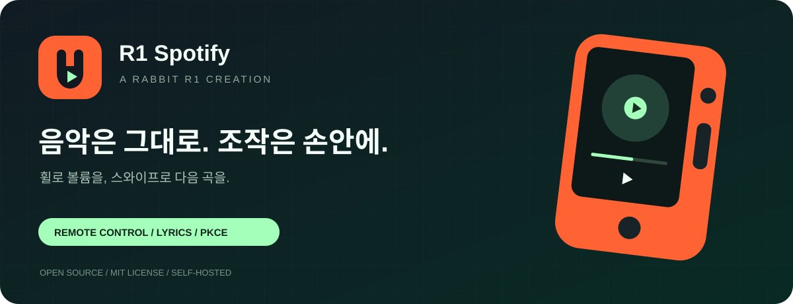
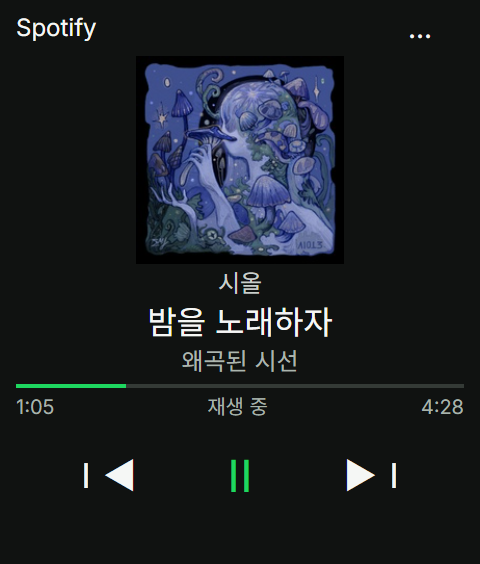
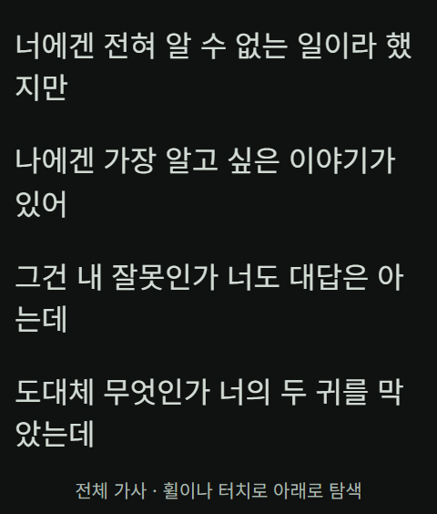
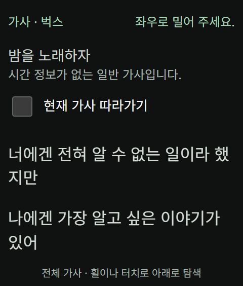

<p align="center"></p>

<p align="center"><strong>한국어</strong> · <a href="README.md">English</a></p>



<p align="center">   <a href="LICENSE"></a></p>

# R1 Spotify

**누구나 설치하고 수정할 수 있는 rabbit r1용 오픈소스 Spotify 리모컨.**

앨범아트·곡명·아티스트·앨범·재생 시간을 확인하고, 스와이프로 곡을 넘기고, 옆 버튼으로 일시정지하고, 휠로 볼륨을 바꿉니다. 별도 PC 없이 r1에서 Creation이 실행되며, 음악은 같은 Spotify 계정의 휴대폰·컴퓨터·스피커에서 계속 재생됩니다.

[시작하기](#시작하기) · [조작 가이드](#조작-가이드) · [음성 요청](#음성-요청) · [직접 배포](#직접-배포) · [개인정보](#개인정보와-인증) · [문제 해결](#문제-해결) · [검증](#검증)

> MIT 라이선스 오픈소스입니다. 사용자는 실행 앱에서 본인 Spotify Client ID를 한 번 설정하고 로그인하며, 직접 배포는 개발자를 위한 선택 사항입니다. 재생 제어에는 Premium·앱 계정 사용 권한·활성 재생 기기가 필요합니다.

## 작은 화면에 맞춘 경험

| 기능 | 제공하는 경험 |
| --- | --- |
| 물리 조작 중심 | 옆 버튼 재생·일시정지, 휠 5% 볼륨 조절, 앨범아트 스와이프 곡 전환 |
| 다국어 음성 요청 | 기기 내 Whisper 인식 → 곡 요청 해석 → Spotify 검색; AI API 키·켜 둔 PC 불필요, 정확도·속도 개선판 실기 확인 필요 |
| 가사 집중 화면 | 앨범아트 탭으로 진입, 휠 탐색, 시간 정보가 있는 가사의 현재 줄 따라가기 |
| 다중 가사 출처 | 벅스 우선 → LRCLIB 정확 조회·검색 → lyrics.ovh 대체 조회 |
| 로그인 복원 | PKCE 인증, 토큰 갱신, 기기에 저장된 세션 복원 |
| 재생 상태 갱신 | 전면에서 약 3초 간격 조회, 진행 시간 보간, 요청 제한 대기 |
| 작은 표시 영역 대응 | 짧은 화면·하단 여백 처리, 기기 진단 정보 |

## 화면 미리보기

<table><tr><th>현재 재생</th><th>가사에 집중</th><th>따라가기 설정</th></tr><tr><td></td><td></td><td></td></tr></table>

시올의 **밤을 노래하자**(앨범 **왜곡된 시선**) 한국어 UI 미리보기입니다. 곡 정보·앨범아트·가사 출처: [벅스](https://music.bugs.co.kr/track/32794635). 재생 상태만 모의 처리했으며 가사는 곡 소유자의 요청에 따라 벅스가 반환한 전체 42줄을 불러왔습니다. 미리보기는 실제 가사 여러 줄로 화면을 채운 모습이며 나머지는 스크롤로 볼 수 있습니다.

## 시작하기

**공용 실행 사이트 + 본인 Spotify Client ID**로 사용합니다. 서버 배포나 저장소 소유자의 Spotify 초대는 필요 없습니다. 처음 설정 후 ‘내 기기’에서는 연결을 복원하고 ‘공용 기기’에서는 이번 실행에만 로그인합니다.

### 준비물

- rabbit r1과 Creation을 추가할 수 있는 환경
- 본인의 Spotify Premium 계정
- Spotify 개발자 설정에 사용할 휴대폰 또는 PC
- 같은 Spotify 계정으로 음악을 재생할 휴대폰·PC·스피커

### 1. 앱을 Creation에 추가

[R1 Spotify 실행 앱](https://r1-spotify-player-jjs1124.plutoparty.chatgpt.site/)의 주소를 rabbit Creation의 실행 URL로 등록합니다. 아래 QR은 같은 실행 주소용이며, Client ID를 발급하거나 계정을 연결해 주는 QR은 아닙니다.

<p align="center"></p>

[Creation 설치 정보](docs/install-creation.json)도 사용할 수 있습니다. 소스 다운로드나 서버 배포는 일반 사용자에게 필요하지 않습니다.

### 2. 본인 Spotify 개발자 앱 만들기

휴대폰이나 PC에서 [Spotify Developer Dashboard](https://developer.spotify.com/dashboard)를 엽니다. **실제로 사용할 본인 Premium 계정**으로 로그인하고 **Create app**을 선택합니다.

| 항목 | 입력 예시 |
| --- | --- |
| App name | My R1 Spotify |
| App description | Personal Spotify remote for my rabbit r1 |
| Website (요청되는 경우) | `https://r1-spotify-player-jjs1124.plutoparty.chatgpt.site/` |
| API/SDK 선택 (표시되는 경우) | Web API |
| Redirect URI | 아래 3단계 주소를 정확히 입력 |

개발자 약관을 확인하고 앱을 생성합니다. Dashboard의 항목 위치와 이름은 바뀔 수 있으며 [Spotify 공식 앱 등록 안내](https://developer.spotify.com/documentation/web-api/concepts/apps)도 참고합니다.

### 3. Redirect URI 등록

생성한 Spotify 앱의 **Settings → Redirect URIs**에 다음 주소를 등록하고 **Save**합니다. 앱 생성 화면에서 등록했다면 저장된 값을 확인합니다.

```text
https://r1-spotify-player-jjs1124.plutoparty.chatgpt.site/
```

**끝의 `/`까지 정확히 일치해야 합니다.** R1 Spotify의 연결 화면에도 현재 주소와 ‘주소 복사’ 버튼이 있습니다. 다른 배포 주소를 쓰는 경우 그 화면의 주소를 등록합니다. GitHub 저장소 주소를 Redirect URI로 넣지 않습니다.

### 4. 휴대폰에서 Client ID를 보내고 로그인

1. r1에서 **휴대폰으로 설정 · QR / 연결 코드**를 누릅니다.
2. **휴대폰 카메라로 r1의 QR을 스캔**합니다. 코드가 자동 입력된 연결 페이지가 열립니다.
3. 휴대폰·PC의 본인 Spotify 앱 **Settings**에서 **Client ID** 32자리를 복사해 연결 페이지에 붙여 넣고 **r1으로 보내기**를 누릅니다.
4. 두 화면의 끝 8자리가 같은지 확인하고 r1에서 **이 Client ID 사용**을 누릅니다.
5. r1에서 **내 기기** 또는 **공용 기기**를 선택하고 **Client ID 저장 후 로그인**을 눌러 Spotify 로그인·동의를 완료합니다.
6. 같은 Spotify 계정의 다른 기기에서 음악을 재생합니다.

**QR을 스캔하기 어렵다면** 휴대폰·PC에서 [연결 페이지](https://r1-spotify-player-jjs1124.plutoparty.chatgpt.site/pair.html)를 열고 r1에 표시된 8자리 코드를 입력합니다. 코드는 10분 동안 유효합니다. 만료·중복 전송·잘못된 ID 수신 시 **새 코드 만들기**를 사용합니다. Client ID 직접 입력도 지원합니다.

**Client Secret은 필요 없으며 입력하지 않습니다.** QR에는 임시 연결 코드만 담깁니다. Client ID와 Spotify 로그인 토큰은 QR에 담기지 않습니다. 서버는 공개 식별자인 Client ID만 전달하고 Spotify 로그인은 r1에서 진행합니다. 받은 ID를 적용해도 직접 로그인하기 전까지 기존 연결을 바꾸지 않습니다.

### 내 기기·공용 기기 선택

Client ID 입력란 위에서 로그인 보관 방식을 선택합니다.

| 선택 | 로그인 보관 | 다시 열었을 때 |
| --- | --- | --- |
| 내 기기 · 로그인 유지 | rabbit 보안 저장소·IndexedDB에 저장 | 저장된 로그인을 복원 |
| 공용 기기 · 이번만 로그인 | 인증 토큰은 현재 페이지 메모리에만 보관 | 새로고침·재실행 시 다시 로그인 |

기기 모드를 바꾸면 기존 연결을 해제하고 저장된 토큰을 삭제합니다. 공용 기기의 OAuth 로그인 준비 정보는 같은 탭의 sessionStorage에만 잠시 보관하고 완료 후 지웁니다. 따라서 로그인 도중 완전히 새 WebView로 돌아오는 기기는 인증을 마치지 못할 수 있습니다. 모드 선택 값은 인증값 없이 보관합니다. 사용 후 ‘이 기기 연결 해제’를 누르고, Spotify 자체 로그인 쿠키까지 종료하려면 Spotify에서도 로그아웃합니다. 앱은 Spotify 웹사이트의 로그인 쿠키를 삭제할 수 없습니다.

### 연결이 안 될 때

| 증상 | 해결 방법 |
| --- | --- |
| Client ID 입력 오류 | Settings의 32자리 Client ID인지 확인합니다. Client Secret이 아닙니다. |
| INVALID_CLIENT / Redirect 오류 | 본인 앱의 Redirect URI가 실행 앱 표시 주소와 끝 슬래시까지 같은지 확인합니다. |
| 로그인 후 403 / 재생 권한 없음 | **본인 앱**의 Users Management에서 로그인 계정의 접근을 확인하고, 필요하면 Add new user에 본인 이름·Spotify 이메일을 등록합니다. Premium과 기기 제한도 확인합니다. |
| 로그인했지만 곡이 안 보임 | 같은 계정의 휴대폰·PC·스피커에서 먼저 곡을 재생합니다. |
| 예전 공용 ID로 연결했음 | 자동 설정된 예전 공용 연결만 해제합니다. 본인이 직접 설정한 ID는 유지합니다. 저장된 ID 불러오기 버튼으로 이전 ID를 복원한 뒤 로그인할 수 있습니다. |

Spotify 개발자 모드의 인증 사용자·요청 제한은 **각 사용자가 만든 Spotify 앱에 적용**됩니다. 이 프로젝트 전체 사용자가 하나의 Client ID를 공유하지 않습니다. 앱 생성 가능 여부와 계정 조건은 Spotify 정책을 따릅니다. [공식 할당량 정책](https://developer.spotify.com/documentation/web-api/concepts/quota-modes)

## 조작 가이드

| 화면 | 입력 | 동작 |
| --- | --- | --- |
| 재생 | 앨범아트 왼쪽 / 오른쪽 스와이프 | 다음 / 이전 곡 |
| 재생 | r1 옆 버튼 한 번 | 재생 / 일시정지 |
| 재생 / 가사 | 마이크 연결 후 r1 옆 버튼을 누른 채 곡명을 말하고 놓기 | 녹음 후 Spotify 가수·곡명 검색; 정확히 일치하는 한 곡은 자동 재생하고 나머지는 후보 선택 |
| 재생 | 음성 검색 버튼 | 준비 상태 확인·마이크 권한 재시도; 준비하는 동안 버튼을 누르고 있을 필요 없음 |
| 재생 | 휠 위 / 아래 | 지원 기기에서 볼륨 +5% / −5%, 0~100% 범위 |
| 재생 | 앨범아트 탭 | 가사 열기 |
| 가사 | 휠 또는 터치 스크롤 | 자유 탐색, 자동 따라가기 해제 |
| 가사 | 탭 또는 Enter | 설정 표시, 다시 탭하면 숨김, 3초 후 자동 숨김 |
| 가사 | ‘현재 가사 따라가기’ 체크 | 현재 줄로 즉시 이동 후 자동 추적 |
| 가사 | 좌우 스와이프 또는 Escape | 곡 변경 없이 재생 화면 복귀 |
| 메뉴 | 점 세 개 | 연결 설정·연결 해제·도움말·기기 확인 |

탭만으로 따라가기를 해제하지 않으며 체크박스 조작 시 설정 표시 시간이 다시 시작됩니다. 일반 가사는 시간 정보가 없어 따라가기가 비활성화됩니다. 세로 이동·짧은 터치·취소된 제스처는 복귀로 처리하지 않습니다. 앱은 WebView 언어에 따라 한국어·영어를 표시하며 가사 원문은 번역하지 않습니다.

## 음성 요청

### API 키 없이 실기에서 확인하기

r32의 기본 방식은 **기기 안에서 Whisper를 실행**합니다. 사용자의 r1에서 시간초과됐던 브라우저 음성 서비스를 대신하며, AI API 키나 계속 켜 둔 PC가 필요하지 않습니다. 처음에는 인터넷으로 공개 모델·실행 파일 **약 65 MB를 내려받습니다.** 인식에 성공한 뒤에도 모델은 메모리에 유지되며, 모델 파일은 사용 가능한 브라우저 캐시를 재사용하므로 버튼을 누를 때마다 다운로드하지 않습니다. 새로고침하면 모델 초기화 시간은 다시 필요합니다. 캐시 삭제·자동 정리·모델 변경·다른 WebView 저장소에서는 재다운로드할 수 있습니다. 래빗 기본 음성 인식기에 직접 연결하는 기능이 아니라 브라우저 안의 로컬 추론입니다.

Creation의 연결 설정에서 **API 키 없이 래빗 음성 테스트**를 눌러 [진단 페이지](https://r1-spotify-player-jjs1124.plutoparty.chatgpt.site/rabbit-test.html?v=20261025-r26-test)를 엽니다. **Spotify 로그인 없이** 시험할 수 있습니다. `20261025-r26-test` 표시를 확인하고 다음 순서로 진행합니다.

1. **Whisper · 기기에서 인식** 모드를 유지하고 **음성 인식 준비**를 누릅니다. 준비 완료까지 기다립니다.
2. 화면 버튼이나 r1 옆 버튼을 누른 채 3~5초 정도 짧게 말한 뒤 놓습니다. 처음 권한 요청이 나오면 허용하고 다시 누릅니다.
3. 인식 문장을 기다립니다. **자동 감지 · Whisper**가 언어를 판단하며 한국어·영어·일본어를 직접 고를 수도 있습니다.
4. 문장을 확인하고 **③ 인식 문장 분석**을 눌러 래빗 AI의 가수·곡명 추출을 시험합니다. 실패하면 진단 결과를 복사합니다.

진단에서는 음성 인식과 래빗 분석을 따로 실행합니다. 오디오는 기기에서 처리하고, 분석 버튼을 눌렀을 때만 인식 문장을 래빗으로 보냅니다. **① 래빗 AI 연결 확인**은 고정 예문으로 텍스트 연결만 확인하므로 음성 인식 성공을 뜻하지 않습니다. 녹음 전용 모드는 바이트 수 확인 후 오디오를 폐기합니다. 비교용 브라우저 음성 모드는 제공자의 인식 서비스로 음성을 보낼 수 있고 `브라우저 기본` 언어는 자동 감지가 아닙니다. 복사 보고서에는 발화 원문·AI 응답 원문·로그인 정보가 포함되지 않습니다.

사용자는 래빗 AI 연결 성공, Web Speech 시간초과, 마이크 녹음 20,262바이트를 보고했습니다. 바이트 수는 녹음 결과가 생성됐다는 근거이며 알아들을 수 있는 발화인지 증명하지는 않습니다. PC Edge의 실제 모델 시험에서는 한국어·영어 감지와 인식이 실행됐지만 한국어 곡명이 잘못 인식됐습니다. 사용자의 r1에서는 “아이유의 밤편지 틀어줘”가 “IU의 편벤지트로저”로 인식됐고 대기가 길었습니다. r26은 준비 동작과 중복 계산을 줄이지만, **새 버전의 r1 속도·정확도와 실제 재생 전체 흐름은 실기 확인이 필요합니다.** [검증 기록](docs/local-voice-verification.md)을 참고합니다.

### 재생 화면에서 곡 요청하기

재생 화면 버튼·음성 창·설정에서 이 기능은 **노래 찾기**로 표시합니다. 버튼 이름은 바뀌지 않으며 마이크 연결·듣는 중·문장 인식·Spotify 검색·재생 확인은 창 안에서 구분합니다.

1. Spotify에 로그인하고 같은 계정의 다른 기기에서 재생을 시작합니다. 연결된 앱이 시작되면 Spotify 재생 정보 응답을 기다리기 전에 모델·마이크·녹음기를 자동 준비합니다. **마이크 준비 중에는 버튼을 놓아 두면 됩니다.** 마이크 권한 창이 나오면 허용합니다. 자동 접근이 거절되면 화면의 권한 허용·재시도 버튼을 한 번 누릅니다. 계속 누르고 있을 필요는 없습니다.
2. **마이크 준비가 끝나면 우측 버튼을 누른 채 말하고, 다 말하면 놓습니다.** 인식 모델이 아직 준비 중이어도 녹음할 수 있습니다. 미리 준비한 녹음기가 재개되며 빨간 표시와 녹음 시간으로 녹음 상태를 확인할 수 있습니다. 놓은 뒤 남은 모델 준비가 끝나면 인식·검색을 진행하며, 누르는 동안 실시간 문장이 나오지는 않습니다. 마이크 준비 전에 눌렀다면 버튼을 놓고 마이크가 준비된 뒤 새로 누릅니다. 준비가 끝났다고 이전 누름의 녹음이 나중에 자동 시작되지는 않습니다. 화면 녹음 버튼도 같은 방식입니다.
3. 로컬 Whisper가 언어를 감지해 문장으로 바꿉니다. “가수의 곡명 틀어줘” 같은 명확한 형식은 즉시 해석합니다. 그 밖의 표현은 재생 명령어를 정리한 문장으로 Spotify에서 직접 검색하며 래빗 AI를 호출하지 않습니다. Spotify에서 제목·가수가 정확히 일치하는 한 곡이면 자동 재생합니다. 일반 문장 검색·불확실한 해석·가수 목록에서 복구한 곡은 후보를 눌러 선택합니다.

r30은 첫 누름 전에 마이크와 일시정지된 녹음기를 미리 준비합니다. 대기 중에는 마이크 장치를 준비 상태로 유지하고 녹음기는 일시정지합니다. 초기화에 필요한 짧은 무음·파일 헤더만 보관할 수 있으며 주변 소리를 대기 녹음하지 않습니다. 녹음 완료·취소 후에는 같은 정상 마이크 연결로 다음 녹음기를 자동 준비합니다. 음성 창을 닫아도 준비 상태를 유지합니다. 앱 숨김·페이지 이탈·Spotify 연결 해제·세션 모드 변경 시 종료하고 늦게 도착한 권한 응답을 폐기합니다. 앱에 돌아오면 다시 자동 준비합니다. 마이크 장치를 유지하므로 브라우저의 마이크 표시가 켜져 있을 수 있습니다. 별도 진단 화면의 명시적인 시험 절차는 유지합니다.

r30은 마이크 권한 요청과 녹음기 시작을 앱 준비 단계에서 처리합니다. 실제 녹음 재개 이벤트에 맞춰 녹음 표시를 켜며, 준비 실패 시에는 계속 누르라는 안내 대신 한 번 눌러 재시도하도록 합니다. 자동 음성 준비 중과 음성 창이 열린 동안 지원되는 브라우저에 화면 켜짐 유지를 요청합니다. 래빗 펌웨어의 절전·앱 종료까지 막는다고 보장하지는 않습니다. 시작 진동은 지원되는 브라우저에서만 동작합니다. 최초 모델 다운로드·초기화와 버튼을 놓은 뒤의 인식 시간은 여전히 필요하며, 이번 변경은 준비를 버튼 누름 이전으로 옮깁니다.

r32는 후보를 누르거나 정확한 곡을 자동 재생할 때 Spotify의 현재 재생 기기를 다시 조회합니다. 요청 응답만으로 끝내지 않고 해당 기기에서 선택한 곡이 재생 중인지 확인합니다. 확인되지 않으면 이유와 후보를 남겨 같은 곡을 다시 누를 수 있으며, 음성을 다시 말할 필요는 없습니다. 활성 기기가 없으면 원하는 휴대폰·PC·스피커에서 Spotify를 먼저 엽니다. 소리는 해당 Spotify 기기에서 재생되며 이 Creation이 래빗 자체에서 음악을 출력하는 것은 아닙니다.

r35는 선택한 곡을 현재 Spotify 기기에서 앨범 방식으로 바로 재생합니다. 사용자는 일반 곡 목록 요청 뒤 재생 정보가 없다는 안내가 나왔지만, r34의 앨범 재생 버튼을 누르면 휴대폰에서 곡이 재생된다고 확인했습니다. 이제 후보 선택과 정확한 곡 자동 재생 모두 처음부터 이 방식을 사용하므로 실패 후 버튼을 한 번 더 누를 필요가 없습니다. 곡이 끝나면 앨범의 다음 곡이 이어질 수 있으며 음성 화면에서 미리 안내합니다. 요청한 곡·재생 상태·대상 기기를 실제 Spotify 응답으로 확인하는 기준은 유지합니다. 확인되지 않으면 후보와 r34의 구체적인 상태 안내를 남깁니다. Spotify 내부에서 일반 요청이 작동하지 않은 원인은 확정하지 않았습니다.

r31은 진행 중인 재생 화면의 음성 요청을 취소해도 모델 다운로드나 준비된 인식 Worker를 유지합니다. 취소한 결과는 버리고 곡 검색·재생에 사용하지 않습니다. 다음 요청은 취소한 계산이 끝나기를 잠깐 기다리며, 새 요청이 기다리는 상태에서 3초가 지나도 끝나지 않으면 Worker를 교체해 다시 준비합니다. 실행 오류·기존 제한 시간 초과·진단 화면의 강제 취소는 Worker를 종료합니다. 페이지를 새로 열면 캐시가 있어도 초기화가 다시 필요합니다. 화면에는 마이크 연결·현재 모델 파일 불러오기·인식기 실행 준비·놓은 뒤의 문장 인식을 구분하며, 표시 시간은 남은 시간이 아닌 경과 시간입니다.

r31은 r26의 언어 감지와 받아쓰기 계산 공유를 유지합니다. 한국어 곡명이 잘못 인식되면 가수의 실제 곡 목록에서도 후보를 찾습니다. 이 처리는 **원래 음성 인식 문장을 교정하거나 정확도를 보장하는 기능이 아니며**, 엉뚱한 제목으로 자동 재생하지 않도록 복구 후보는 선택을 기다립니다.

**“아이유의 밤편지 틀어줘”**, **“Play Yesterday by The Beatles”**처럼 말합니다. 모델에는 번역 대신 원어로 받아쓰도록 지정합니다. 작은 모델은 고유명사·짧은 발화·여러 언어가 섞인 요청을 잘못 인식할 수 있으므로 문장과 검색 후보를 확인합니다. 버튼을 놓으면 녹음이 끝납니다. 15초 제한을 없애고, 버튼이 눌린 채 남는 경우에만 60초·2 MiB의 보호 상한을 적용합니다. 취소·앱 숨김 및 이탈·화면 전환·연결 해제 시 진행 중인 결과를 무효화합니다.

재생에는 여전히 본인의 Spotify Client ID·로그인·Premium·활성 재생 기기가 필요합니다. 기본 음성 경로에는 Gemini 키나 서버 음성 허용 목록이 필요하지 않습니다. 이전 로그인에 검색 권한이 없으면 한 번 다시 연결해 `user-read-private`를 허용합니다. 토큰 갱신만으로 권한이 추가되지는 않습니다. [Spotify 권한 안내](https://developer.spotify.com/documentation/web-api/concepts/scopes)를 참고합니다. [물리 버튼 이벤트](https://github.com/rabbit-hmi-oss/creations-sdk/blob/main/plugin-demo/reference/creation-triggers.md#hardware-button-events)는 열린 Creation에서 사용합니다. 화면 버튼의 음성 검색은 래빗 텍스트 연결이 없어도 동작합니다. 음악은 Spotify 재생 기기에서 계속 재생됩니다.

| 오류 코드 | 대응 |
| --- | --- |
| `model_load_failed` / `local_model_timeout` | 인터넷을 확인하고 다시 준비; 처음에는 모델·실행 파일 다운로드 필요 |
| `local_worker_failed` | 다시 준비; WebView가 실행 중인 작업을 중단했을 수 있음 |
| `local_transcription_timeout` | 3~5초 짧은 문장으로 재시도; 진단에서 한국어를 직접 고르면 언어 감지 단계 생략 |
| `rabbit_no_response` / `rabbit_unmatched_response` | 진단 결과 공유; 현재 요청과 일치하는 텍스트 분석 응답을 받지 못함 |

[Transformers.js](https://huggingface.co/docs/transformers.js/v3.8.1/en/pipelines) **3.8.1**과 다국어 `Xenova/whisper-tiny` q8 모델의 `5332fcc35e32a33b86612b9a57a89be7906102b1` 버전을 고정하고 Web Worker에서 단일 스레드 WASM으로 실행합니다. 해당 라이브러리는 언어를 생략하면 영어를 쓰므로 앱이 언어 분류를 명시적으로 수행합니다. [ONNX Runtime은 Android Chrome/Edge의 WASM을 지원](https://onnxruntime.ai/docs/get-started/with-javascript/web.html#supported-versions)하지만 이것이 r1 WebView 검증을 대신하지는 않습니다.

## 동작 구조


브라우저가 Spotify와 직접 인증·검색·재생 제어를 수행합니다. 같은 출처의 Worker가 UI와 벅스 가사 API를 제공합니다. 기본 음성 요청은 로컬 Whisper로 인식하고 기기에서 요청을 해석한 뒤 Spotify에서 직접 검색합니다. 남겨 둔 Gemini 서버 경로는 개발자용 선택적 통합이며 기본 재생 화면에서 호출하지 않습니다. LRCLIB와 lyrics.ovh는 브라우저의 가사 대체 조회 경로이며 음악은 기존 Spotify 재생 기기에서 재생됩니다.

### 가사 조회

벅스에서는 제목·가수 별칭과 곡 길이 차이 2초 이내를 확인하고 같은 앨범을 우선합니다. 중복을 제거한 최대 세 후보를 검사하며 버전명은 유지합니다. 영어 제목을 한국어로 자동 번역하지 않습니다. 벅스는 일반 가사를 반환하고, 없거나 실패하면 LRCLIB 정확 조회·검색과 lyrics.ovh를 순서대로 사용합니다. 가사 화면을 탭하면 실제 출처를 볼 수 있습니다.

벅스 서버 조회는 전체 20초, 브라우저 대기는 25초로 제한합니다. 성공 응답은 기기에서 5분간 재사용할 수 있습니다. 제공처의 수록 범위·응답·공개 페이지 구조가 바뀌면 조회가 실패할 수 있습니다.

## 호스팅 운영

공용 실행 앱은 기존 Sites 호스팅을 유지합니다. Cloudflare로 이전하지 않습니다. 아래 직접 배포 안내는 포크를 독립 운영하는 개발자용 선택 사항입니다.

## 직접 배포

개발자·독립 운영자용 선택 사항입니다. Git, Node.js 24와 npm, HTTPS 호스팅 계정과 본인의 Spotify Web API 앱을 준비합니다.

```powershell
git clone https://github.com/plutoparty1/Rabbit_R1.git
cd Rabbit_R1/r1-spotify
```

배포 후 Spotify Dashboard에 자신의 정확한 HTTPS Redirect URI를 등록하고 앱의 연결 화면에서 본인 Client ID를 입력합니다. [설치 정보 템플릿](docs/install-creation.example.json)의 URL과 rabbit Creation 실행 주소도 본인 배포 주소로 맞춥니다.


프런트엔드와 서버는 별도 애플리케이션 패키지 설치 없이 빌드됩니다. 배포 도구 Wrangler는 `npx`로 실행할 때 내려받습니다. 아래 명령은 `r1-spotify` 폴더에서 실행합니다.

```powershell
node scripts/build.mjs
npx wrangler login
npx wrangler deploy --config wrangler.jsonc
```

[Wrangler 설정 예제](wrangler.jsonc)는 생성된 `dist/server/index.js`를 진입점으로 사용하며 빌드를 배포 전에 실행합니다. 필요하면 `name`을 변경합니다. 배포 계정은 본인 Cloudflare 계정을 사용합니다. CLI가 출력한 HTTPS 주소를 Spotify Redirect URI와 rabbit Creation URL에 등록합니다. 설정 항목은 [Cloudflare 공식 문서](https://developers.cloudflare.com/workers/wrangler/configuration/)를 참고합니다.

로컬에서 화면과 서버를 함께 확인하려면:

```powershell
node scripts/build.mjs
npx wrangler dev --config wrangler.jsonc --port 8791
```

이 주소는 개발용입니다. r1 설치와 실제 Spotify 로그인은 위에서 배포한 HTTPS 주소로 진행합니다. 프런트엔드를 수정한 뒤에는 다시 빌드합니다. 빌드는 기존 `dist` UI와 서버 모듈을 Worker로 묶습니다. 다른 호스팅은 같은 모듈 Worker 인터페이스와 `/api/lyrics/bugs`를 지원해야 합니다. 음성 페이지·Worker의 Content Security Policy에서 WASM 실행, jsDelivr 실행 파일 및 Hugging Face 모델 다운로드 허용을 유지합니다.

### 이전 Gemini 서버 경로 — 개발자 선택 사항

서버 음성 모듈은 포크에서 명시적으로 연결하려는 개발자를 위해 남겨 두었습니다. **r27 기본 재생 화면은 로컬 Whisper를 사용하며 `/api/voice/config`나 `/api/voice/search`를 호출하지 않습니다. 비밀값을 설정하는 것만으로 Gemini 방식으로 전환되지 않습니다.** 기본 경로에는 아래 설정이 필요하지 않습니다. 별도 호출부를 구현할 때 인증된 `POST /api/voice/search` 규약을 사용하고 오디오 전송을 안내해야 합니다. 공용 앱은 기존 Sites 호스팅을 유지하며 Wrangler 안내는 독립 포크에만 적용합니다.

| 서버 설정 | 용도 |
| --- | --- |
| `GEMINI_API_KEY` | 필수 Gemini API 서버 비밀값. 프런트엔드 파일·Git 커밋·공개 설정 파일에 넣지 않습니다 |
| `VOICE_ALLOWED_SPOTIFY_USERS` | 필수 허용 목록. `GET https://api.spotify.com/v1/me`가 반환하는 Spotify **사용자 ID**를 쉼표로 구분합니다. 불변 `account_id`를 우선 사용하며 `id`도 지원합니다. 이메일·Client ID와 다릅니다 |
| `VOICE_MODEL` | 선택 사항인 Gemini 모델 지정. 기본값은 `gemini-3.8-flash`입니다. 본인 프로젝트에서 사용 가능하며 오디오 입력·구조화된 JSON 출력을 지원하는 모델을 사용합니다 |

독립 Wrangler 배포에서는 `npx wrangler secret put GEMINI_API_KEY --config wrangler.jsonc`로 API 키를 설정합니다. 배포 환경 변수에 `VOICE_ALLOWED_SPOTIFY_USERS`와 필요한 경우 `VOICE_MODEL`을 추가합니다. 로컬 개발은 같은 이름을 추적하지 않는 `.dev.vars` 파일에 설정합니다. 실제 키와 사용자 ID는 커밋하지 않습니다.

이 선택적 API는 Authorization 헤더의 현재 Spotify 접근 토큰으로 `/v1/me`를 조회하고 사용자 ID의 허용 여부를 확인한 뒤 Gemini를 호출합니다. 익명 요청은 허용하지 않습니다. `GET /api/voice/config`는 해당 서버 설정의 존재 여부만 반환하며 제공처 인증값을 시험하지는 않습니다. Gemini 설정이 없어도 기본 로컬 음성 경로는 비활성화되지 않습니다.

Spotify 사용자별로 분당 6회·시간당 60회·동시 1회 요청을 **현재 실행 중인 Worker 인스턴스 단위**로 제한합니다. 메모리 기반이므로 여러 인스턴스나 재시작에 걸친 전체 할당량은 아닙니다. 여러 사용자가 쓰는 배포는 제공처의 비용·사용량 제한이나 공통 게이트웨이 할당량도 설정합니다. Spotify 신원 확인은 8초, Gemini 요청은 25초로 제한하며 유료 추론을 자동 재시도하지 않습니다. JSON 요청은 최대 3 MiB, 디코딩한 오디오는 최대 2 MiB입니다. WebM·Ogg·WAV·MP3/MPEG·AAC·FLAC·M4A·Opus 형식을 받으며 MP4 오디오는 제공처 전송 시 M4A로 정규화합니다.

Gemini의 [오디오 입력](https://ai.google.dev/gemini-api/docs/audio)과 [generateContent API](https://ai.google.dev/api/generate-content)를 사용합니다. 배포 전 본인 프로젝트의 [모델 사용 가능 여부](https://ai.google.dev/gemini-api/docs/models/gemini-3.8-flash)를 확인합니다.

### 저장소를 공유하는 방법

- **사용 안내:** 실행 앱 주소 또는 QR과 빠른 시작 안내를 공유합니다.
- **수정본 공유:** 포크한 저장소를 공유하고 MIT 저작권·라이선스 고지를 유지합니다.
- **하나의 서버를 함께 사용:** 운영자는 호스팅을 관리하고, 각 사용자는 위 안내에 따라 본인 Spotify 앱을 등록하고 연결합니다.

Spotify의 개발자 모드 제한은 **각 Spotify 앱**에 적용됩니다. 저장소를 포크하거나 소스를 다운로드할 수 있는 인원 제한이 아닙니다. 2026-10-18 확인 기준 앱 소유자는 Premium이어야 하며 앱당 인증 사용자는 최대 5명이고 허용 목록 등록이 필요합니다. 하나의 Client ID로 더 많은 사용자에게 제공하려면 별도의 확장 할당량 승인이 필요합니다. 최신 조건은 [Spotify 공식 정책](https://developer.spotify.com/documentation/web-api/concepts/quota-modes)을 확인합니다.

## 개인정보와 인증

공용 배포는 사용자의 개인 Client ID와 Spotify 로그인으로 재생을 제어합니다. 저장소 소유자의 Spotify 계정을 공유하지 않습니다. 2026-10-18 서버의 이전 가사 브리지 URL·인증 키를 제거하고 재배포했으며 개인 Spotify 세션 없이 공개 가사 제공처로 대체 조회합니다. 사이트 호스팅은 프로젝트 운영자의 Sites 계정이 담당합니다. 같은 기기·브라우저를 다른 사람에게 넘기기 전에는 연결을 해제합니다.

| 데이터 | 처리 방식 |
| --- | --- |
| 접근·갱신 토큰 | 내 기기: 보안 저장소·IndexedDB; 공용 기기: 현재 페이지 메모리만 사용; localStorage에는 저장하지 않음. 기본 음성 경로는 Spotify 토큰을 래빗·음성 서버로 보내지 않음. 별도 구현한 이전 서버 경로만 신원 확인용 접근 토큰을 사용. 갱신 토큰은 Spotify로만 전송 |
| 진행 중 OAuth 정보 | 내 기기: localStorage, 공용 기기: 같은 탭 sessionStorage에 10분 유효 기간으로 보관; 일회용 state·PKCE 사용, 완료·연결 해제·만료 확인 시 폐기 |
| Client ID | 내 기기: localStorage, 공용 기기: 같은 탭 sessionStorage에 공개 식별자만 저장 |
| 휴대폰 연결 중계 | 공개 Client ID·수신 기기 확인용 해시·만료 시각을 Sites 저장소에 임시 저장. Spotify 인증값은 저장하지 않음. 적용·취소한 요청은 삭제하며 만료 즉시 사용 불가. 방치된 만료 기록은 새 연결 생성 시 정리 |
| 벅스 조회 | 제목·가수·앨범·곡 길이만 전달, Spotify 토큰 미전송 |
| 다른 가사 조회 | 해당 제공처에 곡 메타데이터 전달, Spotify 인증값 미전송 |
| 기본 음성 요청 | 오디오를 업로드하지 않고 기기에서 디코딩·인식. 추출한 가수·곡명 또는 정리한 검색 문장을 Spotify로 전송. 재생 화면은 래빗 AI를 호출하지 않으며 녹음·인식문을 영구 저장하거나 로그로 남기지 않음 |
| 모델·실행 파일 다운로드 | jsDelivr·Hugging Face의 공개 파일, AI API 키 불필요. 브라우저 캐시에 모델이 남을 수 있으며 녹음은 저장하지 않음 |
| 선택적 이전 Gemini 호출부 | 개발자가 별도로 연결한 경우에만 오디오를 사이트 서버·Gemini로 전달. Spotify 인증값은 Gemini로 보내지 않음. 제공처 처리·보관은 운영자의 서비스 설정·약관에 따름 |

IndexedDB는 브라우저 저장소이며 하드웨어 암호화 저장소가 아닙니다. 보안 저장 성공 응답이 실제 저장을 보장하지 않을 수 있어 백업을 유지합니다. 보안 저장소 초기화는 제한된 시간 동안 재확인하며, 영구 저장 확인 후 로그인 유지로 안내합니다.

연결 해제 시 저장된 인증값을 지우고, 보안 저장소에 예전 토큰이 남아도 복원되지 않도록 해제 기록을 남깁니다. 브라우저 데이터 삭제·저장소 차단·Spotify 권한 취소 시 재로그인이 필요할 수 있습니다. 기기나 프로필을 넘기기 전에 연결을 해제합니다. OAuth 콜백 코드는 주소에서 제거하며 인증값을 이슈·화면 캡처·QR·로그에 넣지 않습니다.

## 문제 해결

| 증상 | 확인 사항 |
| --- | --- |
| 예전 링크에서 ChatGPT 로그인 요구 | Creation 실행 URL을 본인이 배포한 Worker 주소로 변경 |
| OAuth Redirect 오류 | Dashboard의 HTTPS 주소와 끝 슬래시까지 일치하는지 확인 |
| 로그인 후 제어가 403 | 허용 목록·Premium·재생 기기 제한 확인 |
| 현재 곡 없음 | 같은 계정의 다른 기기에서 Spotify 재생 시작 |
| 볼륨 변화 없음 | 기기 확인에서 원격 볼륨 지원 확인; 운영체제만으로 지원 여부를 판단하지 않음 |
| 가사가 따라오지 않음 | 시간 정보가 있는 가사인지 확인 후 따라가기 체크 |
| 가사 없음 | 네트워크·제공처 장애·제목 및 버전·곡 길이 일치 여부 확인 |
| 재실행하면 로그인 해제 | 저장 진단 확인; 데이터 삭제·저장 차단·권한 취소 시 재연결 |
| 요청 제한 또는 오프라인 | 앱은 Retry-After를 따르고 마지막 정보임을 표시; 명령 연타 자제 |
| 복귀 후 오래된 화면·버튼 잘림 | 기기 확인의 버전·표시 영역과 배포 자원 확인 |
| 음성 모델 준비 전 / 다운로드 실패 | 재생 화면에서 자동 준비; 실패하면 다시 시도. 첫 다운로드·재실행 시 준비가 필요할 수 있음 |
| r1에서 인식 시간초과 | 로컬 Whisper 모드에서 3~5초 짧게 말한 뒤 단계·오류 코드 공유; r1 로컬 추론 속도는 아직 확인 전 |
| 래빗 AI 사용 불가 | 재생 화면은 래빗 AI에 의존하지 않습니다. 별도 진단 화면의 텍스트 분석 시험에만 사용합니다. |
| 기존 로그인에 검색 권한 필요 | 연결을 해제하고 한 번 다시 로그인해 `user-read-private` 허용; 토큰 갱신만으로는 권한이 추가되지 않음 |
| 마이크 권한 거부 / 녹음 미지원 | 마이크 접근을 허용하고 HTTPS 주소를 사용; 현재 r1 WebView의 녹음 지원 확인 |
| 다른 곡 또는 여러 곡이 검색됨 | 가수와 제목을 함께 또렷하게 말하고 표시된 후보 확인; 고유명사와 언어가 잘못 인식될 수 있음 |
| 음성 인식 후 재생 실패 | 같은 계정의 다른 기기에서 Spotify를 켜고 Premium·기기 제한·Spotify 접근 확인 |

백그라운드에서는 조회를 중단합니다. 복귀 신호는 하나로 모으고 화면 크기를 재확인하며, 오래된 응답과 대기 볼륨 입력을 무효화합니다. 가능한 경우 표시된 가사와 자유 탐색 위치를 유지합니다. 실패한 다음 곡 명령을 무조건 재전송하지 않습니다.

## 전체 가사와 스크롤

실제 가사 화면은 고정된 발췌가 아니라 제공처가 반환한 모든 문단을 표시합니다. 휠·터치로 탐색하고 마지막 문단에서는 하단 안내가 ‘가사 끝’으로 바뀝니다. 제공처별 줄바꿈을 정규화하며 시간 정보가 없는 일반 가사는 자동 따라가기를 지원하지 않습니다. 제공처가 누락한 가사 자체를 복원하는 기능은 아닙니다. 정적 미리보기 이미지는 화면에 보이는 구간만 보여줍니다. 브라우저 회귀 시험에서 예시 120문단 전체와 마지막 문단 도달을 확인합니다.

## 개발 안내

```text
r1-spotify/
├── dist/                 HTML·CSS·브라우저 ES 모듈 (프런트엔드 원본)
├── server/               Worker 진입점·벅스 조회·선택적 음성 서비스
├── scripts/build.mjs     UI 포함 및 dist/server/ 생성
├── tests/                Node 테스트·Playwright 콜백 시나리오
├── docs/                 설치·화면·검증 기록·SVG
├── wrangler.jsonc 배포 설정 예제
├── LICENSE               r1-spotify MIT 라이선스
└── DESIGN.md             UI 설계 기록
```

### 검증

```powershell
node scripts/build.mjs
node --test tests/*.test.mjs
node --check dist/app.mjs
node --check dist/spotify.mjs
```

Node 테스트는 핵심 로직·OAuth·Spotify·가사 매칭·벅스·음성 녹음 및 후보 선택·Worker 응답을 다룹니다. `tests/*-check.js`는 독립 실행 명령이 아닌 Playwright 콜백 함수입니다. `dist`를 `http://127.0.0.1:8791/`에 제공한 뒤 Playwright Page를 인수로 호출합니다. 대부분 Spotify와 가사를 모의 처리하며, `bugs-browser-check.js`는 모의 재생과 실제 벅스 조회를 사용합니다. 별도 린트·타입 검사 설정은 없습니다.

| 근거 | 범위와 한계 |
| --- | --- |
| Node 테스트 | 재현 가능한 로직 검증이며 실기 동작을 보장하지 않음 |
| 기존 브라우저 시나리오 기록 | 240×282 및 작은 화면·제스처·휠·따라가기·인증 복원·볼륨·앱 복귀 |
| r22 음성 브라우저 시나리오 | 한국어·영어 Edge 240×282 및 240×240: 자동 재생·후보 선택·취소·오류·미설정 서비스 확인; 마이크·음성 인식·Spotify 응답은 모의 처리 |
| r25 실제 모델 브라우저 시험 | PC Edge WASM에서 한국어·영어 언어 감지와 인식 실행. 한국어 곡명은 오인식. r1 속도·정확도나 실제 Spotify 재생의 검증은 아님. [기록](docs/local-voice-verification.md) |
| 사용자 r1 진단 보고 | 래빗 AI 연결 성공, 브라우저 인식 시간초과, 마이크 20,262바이트 수집. r25 로컬 인식은 실행됐지만 대기 시간이 길고 한국어 곡명 오인식 보고 |
| 과거 r6 사용자 실기 보고 | 로그인 유지·휠 입력·가사 자유 탐색 및 따라가기·재생 버튼 표시 |
| 추가 확인 필요 | 최신 WebView 전체 흐름·r7 탭 설정 실기·다중 사용자 공유·기기별 볼륨; r1 녹음 디코딩·로컬 Whisper 속도와 정확도·음성 요청의 Spotify 재생 |

소스 UI 버전은 `20261025-r35`입니다. 자신의 배포 버전은 기기 확인에서 확인합니다. [로컬 음성 검증 기록](docs/local-voice-verification.md)은 사용자 보고·PC 실제 모델 시험·미완료 r1 시험을 구분합니다. [verification.json](docs/verification.json)은 2026-10-08 기준 과거 기록이며 신규 인증 결과가 아닙니다. 상세 구현·시험 기록은 [기존 한국어 문서 보관본](docs/archive/README.2026-10-18.ko.md)에 보존했습니다.

## 라이선스

이 `r1-spotify/` 프로젝트의 코드와 직접 제작한 문서·SVG는 [MIT 라이선스](LICENSE)로 공개합니다. 사용·수정·복제·재배포·상업적 이용이 가능하며 저작권 및 라이선스 고지를 유지해야 합니다. 이 라이선스는 다른 하위 프로젝트에 적용되지 않습니다. 외부 서비스·상표·앨범아트·가사 등 제3자 콘텐츠의 권리는 각 소유자에게 있으며 MIT 허용 범위에 포함되지 않습니다.

## 글꼴

영문은 [Inter](https://rsms.me/inter/), 한글은 [Noto Sans KR](https://fonts.google.com/noto/specimen/Noto+Sans+KR)을 사용합니다. 두 폰트는 SIL Open Font License로 배포하며 [라이선스 고지](dist/fonts)를 포함합니다. 폰트는 사이트에서 직접 제공하므로 방문 시 Google Fonts 서버에 접속하지 않습니다. GitHub README 본문 글꼴은 GitHub가 결정하고, 이 글꼴은 실행 앱과 미리보기에 적용됩니다.

## 기여하기

1. 저장소를 포크하고 작업 브랜치를 만듭니다.
2. 프런트엔드는 `dist/`, 서버는 `server/`에서 수정합니다.
3. 빌드와 관련 테스트를 실행하고 변경된 동작을 확인합니다.
4. 한국어·영어 문서를 함께 갱신하고 Pull Request에 변경 내용과 검증 결과를 적습니다.

## 문의와 참고 자료

[GitHub Issues](https://github.com/plutoparty1/Rabbit_R1/issues)에 표시 버전·기기/WebView·화면 크기·재생 기기·재현 단계·인증값을 제거한 진단 정보를 남겨 주세요. 문서를 수정할 때 한국어·영어 내용을 함께 맞추고 모의 화면과 실기 결과를 구분합니다.

- Spotify [재생 상태](https://developer.spotify.com/documentation/web-api/reference/get-information-about-the-users-current-playback) · [볼륨 제어](https://developer.spotify.com/documentation/web-api/reference/set-volume-for-users-playback) · [PKCE 인증](https://developer.spotify.com/documentation/web-api/tutorials/code-pkce-flow)
- [rabbit 하드웨어 이벤트·보안 저장소](https://github.com/rabbit-hmi-oss/creations-sdk/blob/main/plugin-demo/reference/creation-triggers.md)
- [LRCLIB](https://lrclib.net/docs) · [lyrics.ovh](https://github.com/NTag/lyrics.ovh#api)

직접 제작한 SVG 프로젝트 로고·히어로·구조도는 [docs/assets](docs/assets)에 있습니다. 기기 일러스트는 개념 이미지입니다. Spotify와 rabbit 명칭의 권리는 각 소유자에게 있으며 공식 제휴·보증 프로젝트가 아닙니다. [jev-gate](https://github.com/MongLong0214/jev-gate)의 시각적 정보 구성을 참고했고 해당 에셋을 복제하지 않았습니다.

### 휴대폰 연결 호스팅

기존 Sites 호스팅에서 `PAIRING`이라는 R2 바인딩으로 중계합니다. 사용자가 별도 호스팅 계정을 만들 필요가 없으며 호스팅을 이전하지 않습니다. 무작위 8자리 코드는 10분 후 만료되고 ID 전송은 한 번만 가능합니다. 별도의 256비트 수신 비밀값을 가진 원래 기기만 ID를 가져올 수 있습니다. 같은 출처 확인·요청 크기 제한·IP별 요청 제한을 적용합니다. QR은 MIT 라이브러리로 기기에서 생성하며 외부 QR 서비스에 주소를 보내지 않습니다.

직접 호스팅하는 개발자는 Worker에 `PAIRING` 이름으로 R2 버킷을 연결합니다. Wrangler 예제에 해당 바인딩을 선언했으므로 버킷을 만들고 예제 버킷명을 변경합니다. 저장소가 없으면 휴대폰 연결은 사용 불가로 안내하고 직접 입력·로그인은 계속 동작합니다. [QR 라이브러리 라이선스](docs/licenses/qrcode-generator-LICENSE.txt).
