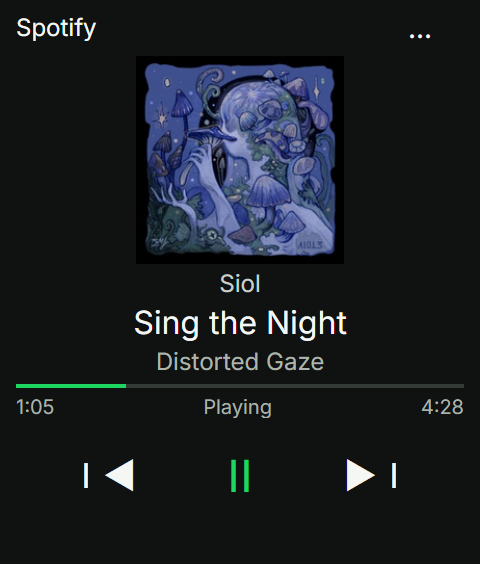
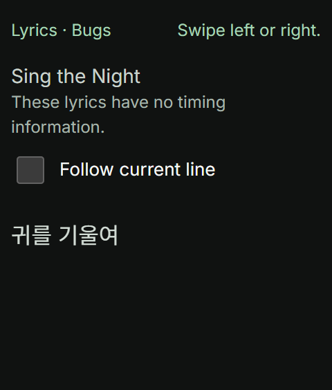

<p align="center"></p>

<p align="center"><strong>English</strong> · <a href="README.ko.md">한국어</a></p>


<p align="center">   <a href="LICENSE"></a></p>

# R1 Spotify

**An open-source Spotify remote for rabbit r1. Build it, host it, make it yours.**

See the artwork, track, artist, album and playback progress. Swipe to skip, press the side button to pause, and turn the wheel for volume. The Creation runs on r1 without a companion PC; audio continues on the active phone, computer or speaker signed in to the same Spotify account.

[Get started](#get-started) · [Controls](#controls) · [Self-host](#self-host) · [Privacy](#privacy-and-authentication) · [Troubleshooting](#troubleshooting) · [Verification](#verification)

> Open-source under MIT. Open the hosted app, enter your own Spotify Client ID once, then sign in. Self-hosting is optional for developers. Playback control requires Spotify Premium, app account access and an active playback device.

## Built for a small screen

| Capability | What you get |
| --- | --- |
| Hardware-first control | Side-button play/pause; wheel volume in 5% steps; artwork swipe for previous/next |
| Focused lyrics | Tap artwork to open lyrics; scroll with the wheel; follow the current line when timestamps exist |
| Multiple lyric sources | Bugs first, then LRCLIB exact/search and lyrics.ovh fallback |
| Session recovery | PKCE login, token refresh and on-device session restoration |
| Resilient playback state | Approximately 3-second foreground polling, interpolated progress and rate-limit backoff |
| Compact layout | Short viewport handling, bottom spacing and device diagnostics |

## Preview

<table><tr><th>Now playing</th><th>Lyrics focus</th><th>Follow controls</th></tr><tr><td></td><td></td><td></td></tr></table>

English UI previews feature **Sing the Night** by **Siol**, from **Distorted Gaze** (metadata translated for the preview). Track information, artwork and original Korean lyrics: [Bugs](https://music.bugs.co.kr/track/32794635). Playback state is mocked; lyrics screenshots show a short excerpt fetched from the real provider response. The live app renders the complete returned lyrics with scrolling. Original lyrics are not translated.

## Get started

Use the **hosted app with your own Spotify Client ID**. You do not need a server deployment or an invitation to the repository owner's Spotify app. After setup, My device restores your connection; Shared device signs in for this page only.

### What you need

- A rabbit r1 with access to add a Creation
- Your own Spotify Premium account
- A phone or computer for Spotify developer setup
- A phone, computer or speaker playing Spotify on that same account

### 1. Add the app to Creation

Register the [hosted R1 Spotify URL](https://r1-spotify-player-jjs1124.plutoparty.chatgpt.site/) as your rabbit Creation launch URL. The QR below points to that same URL; it does not issue a Client ID or connect your account.

<p align="center"></p>

The [Creation configuration](docs/install-creation.json) also contains the launch information. Users do not need to download source or deploy a server.

### 2. Create your own Spotify developer app

On a phone or computer, open [Spotify Developer Dashboard](https://developer.spotify.com/dashboard). Sign in with **the Premium account you will use**, then select **Create app**.

| Field | Example |
| --- | --- |
| App name | My R1 Spotify |
| App description | Personal Spotify remote for my rabbit r1 |
| Website (if requested) | `https://r1-spotify-player-jjs1124.plutoparty.chatgpt.site/` |
| API/SDK selection (if shown) | Web API |
| Redirect URI | The exact address in step 3 below |

Review the developer terms and create the app. Dashboard labels and placement may change; see [Spotify's official app setup guide](https://developer.spotify.com/documentation/web-api/concepts/apps).

### 3. Register the Redirect URI

In your Spotify app, open **Settings → Redirect URIs**, add the following address, and **Save**. If you entered it while creating the app, check the saved value.

```text
https://r1-spotify-player-jjs1124.plutoparty.chatgpt.site/
```

**Match the trailing `/` too.** R1 Spotify's connection screen shows its current address with a copy button. For another deployment, register the address shown there. Do not use the GitHub repository URL as your Redirect URI.

### 4. Enter your Client ID on r1 and log in

1. Copy the 32-character **Client ID** from your own Spotify app's **Settings**.
2. Enter or paste it into **Client ID** on r1's R1 Spotify connection screen.
3. Select **Save Client ID and log in**, then sign in and grant access with your own Spotify account.
4. Play a track on another device with the same account and check information and controls on r1.

**No Client Secret is needed or accepted.** The Client ID preference is saved per device/browser: entering it on your phone does not configure r1. You do not need to embed a personal Client ID or tokens in the QR.

### Choose My device or Shared device

Choose a login retention mode above the Client ID field.

| Choice | Credential storage | When reopened |
| --- | --- | --- |
| My device · keep me signed in | rabbit secure storage and IndexedDB | Restores the saved login |
| Shared device · this visit only | Tokens remain in the current page's memory only | Login required after reload or reopening |

Changing modes disconnects and removes saved tokens. Shared-mode OAuth preparation is kept only in the same tab's sessionStorage and cleared after completion. A device that returns OAuth in a completely new WebView may therefore be unable to finish shared-mode login. The non-secret mode preference is retained. Disconnect when finished; sign out on Spotify too if you need to end Spotify's own browser login. This app cannot delete Spotify website cookies.

### If connection fails

| Symptom | Action |
| --- | --- |
| Invalid Client ID | Use the 32-character Client ID from Settings, not the Client Secret. |
| INVALID_CLIENT / redirect error | Check your app's Redirect URI against the launch app's displayed address, including the trailing slash. |
| 403 / playback permission denied after login | Check account access in **your own app's** Users Management; if needed, add your name and Spotify email with Add new user. Also check Premium and device restrictions. |
| Signed in but no track appears | Start playback on a phone, computer or speaker using the same account. |
| Previously used the shared ID | This version disconnects the retired shared connection. Enter your own Client ID and log in again. |

Spotify development-mode user and request limits apply to **each user's own Spotify app**. Users of this project do not share a single Client ID. App creation eligibility and account requirements remain subject to Spotify policy. [Official quota policy](https://developer.spotify.com/documentation/web-api/concepts/quota-modes)

## Controls

| Screen | Input | Action |
| --- | --- | --- |
| Player | Swipe artwork left / right | Next / previous track |
| Player | Press r1 side button once | Play / pause |
| Player | Wheel up / down | Volume +5% / −5%, within 0–100%, if supported by the active device |
| Player | Tap artwork | Open lyrics |
| Lyrics | Wheel or touch scroll | Explore freely; turns off automatic following |
| Lyrics | Tap, or press Enter | Reveal controls; another tap hides them; auto-hide after 3 seconds |
| Lyrics | Enable “현재 가사 따라가기” | Jump to and follow the current timed line |
| Lyrics | Swipe left / right, or Escape | Return to player without skipping tracks |
| Menu | Three dots | Connection settings, disconnect, help and device diagnostics |

Tapping lyrics preserves follow mode. Checkbox interaction restarts the controls timer. Plain lyrics have no timed follow mode. Vertical drags, short touches and cancelled gestures do not close lyrics. The app follows the WebView language for Korean/English UI; original lyrics are not translated.

## How it works


The browser calls Spotify directly for authentication and playback control. A same-origin Worker serves the UI and the Bugs lyrics endpoint. LRCLIB and lyrics.ovh are browser fallbacks. This project controls an existing Spotify player; it does not stream audio to r1.

### Lyrics lookup

Bugs matching checks title, artist aliases and a duration difference of at most 2 seconds, prefers the same album, and examines at most three deduplicated candidates. Version names are retained; English titles are not automatically translated into Korean. Bugs returns plain lyrics. If unavailable, the client tries LRCLIB exact lookup and search, then lyrics.ovh. Tap the lyrics view to see the actual provider.

Bugs server lookup has a 20-second budget; the browser waits up to 25 seconds. Successful responses can be reused by the device for 5 minutes. Provider availability, coverage and public page structure may change.

## Hosting

The public app remains on its existing Sites hosting. It is not being migrated to Cloudflare. The self-hosting instructions below are optional for developers operating an independent fork.

## Self-host

Optional for developers and independent operators. Prepare Git, Node.js 24 with npm, an HTTPS hosting account and your own Spotify Web API app.

```powershell
git clone https://github.com/plutoparty1/Rabbit_R1.git
cd Rabbit_R1/r1-spotify
```

After deployment, register your exact HTTPS Redirect URI in Spotify Dashboard and enter your Client ID in connection settings. Update the [installation template](docs/install-creation.example.json) and rabbit Creation launch URL to your own deployment.


The frontend and server build without application package installation. `npx` downloads Wrangler when needed. Run these commands from `r1-spotify`:

```powershell
node scripts/build.mjs
npx wrangler login
npx wrangler deploy --config wrangler.jsonc
```

The [Wrangler example](wrangler.jsonc) uses the generated `dist/server/index.js` entry point and runs the build before deployment. Change `name` if desired and deploy through your own Cloudflare account. Register the HTTPS URL printed by the CLI in Spotify and rabbit Creation. See the [Cloudflare configuration reference](https://developers.cloudflare.com/workers/wrangler/configuration/) for configuration details.

To preview the frontend and server locally:

```powershell
node scripts/build.mjs
npx wrangler dev --config wrangler.jsonc --port 8791
```

The local address is for development. Use your deployed HTTPS URL for r1 installation and actual Spotify login. Rebuild after frontend edits. The build bundles the existing `dist` UI with `bugs.mjs` and `assets.mjs` into the Worker. Other hosting must support the same module Worker interface and `/api/lyrics/bugs` route.

### Sharing the project

- **Help others use the app:** Share the hosted app URL or QR and the quick-start instructions.
- **Share your modifications:** Publish your fork and retain the MIT copyright and license notice.
- **Operate a shared instance:** The operator manages hosting; each user registers and uses their own Spotify app as described above.

Spotify development-mode limits apply to **each Spotify app**, not to how many people may fork or download the source. As checked on 2026-10-18, the app owner needs Premium and each app supports up to five authenticated, allowlisted users. Serving a larger audience with one Client ID requires separate extended quota approval. Check the [official Spotify policy](https://developer.spotify.com/documentation/web-api/concepts/quota-modes) for current conditions.

## Privacy and authentication

The hosted app controls playback using each user's own Client ID and Spotify login, without sharing the repository owner's Spotify account. On 2026-10-18, the old server-side lyrics bridge URL and authentication key were removed and the app redeployed. Public lyric providers supply fallback lyrics without a personal Spotify session. Hosting remains under the operator's Sites account. Disconnect before another person uses the same device/browser.

| Data | Handling |
| --- | --- |
| Access and refresh tokens | My device: native secure storage plus IndexedDB; Shared device: page memory only; not localStorage or the site server |
| Pending OAuth transaction | My device: localStorage; Shared device: same-tab sessionStorage; 10-minute expiry, one-time state and PKCE verifier; removed on completion, disconnect or expiry checks |
| Client ID | Public identifier only; localStorage for My device, same-tab sessionStorage for Shared device |
| Bugs request | Track title, artist, album and duration only; no Spotify token |
| Other lyrics requests | Track metadata sent to the selected provider; no Spotify credentials |

IndexedDB is browser storage, not a hardware-encrypted vault. The backup remains because a native storage success response may not guarantee persistence. Secure storage initialization is retried for a bounded time; persistent storage must be confirmed before the app reports that login will survive reopening.

Disconnect removes saved credentials and records a logout marker to block restoration from stale native storage. Clearing browser data, blocked storage or revoked Spotify permission may require login again. Disconnect before handing a shared device/profile to another person. OAuth callback codes are removed from the address; do not put tokens, credentials or authorization codes in issues, screenshots, QR codes or logs.

## Troubleshooting

| Symptom | Check or action |
| --- | --- |
| An old link asks for ChatGPT login | Use your own Worker deployment URL registered in your Creation |
| OAuth redirect error | Match the exact HTTPS URI, including trailing slash, in the Dashboard |
| Login succeeds; controls return 403 | Check the allowlist, Premium account and playback-device restrictions |
| No current track | Start Spotify playback on another device with the same account |
| Volume does not change | Inspect device diagnostics; remote volume support depends on the active device, not merely its operating system |
| Lyrics do not follow | Check whether the provider returned timestamps, then enable the follow checkbox |
| Lyrics are missing | Check connectivity and provider availability; mismatched title/version/duration can prevent a match |
| Login is lost after reopening | Inspect storage diagnostics; reconnect if storage was cleared, blocked or authorization revoked |
| Rate limited / offline | The app respects Retry-After and labels last-known data; avoid repeated manual commands |
| Old or cropped UI after returning | Check the displayed version and viewport in diagnostics; compare deployment assets with source |

Foreground polling pauses while the app is hidden. Resume signals are coalesced, viewport size is rechecked, stale responses and queued volume input are invalidated, and displayed lyrics/free-scroll position are retained where possible. Failed skip commands are not blindly retried.

## Full lyrics and scrolling

The live view renders every returned paragraph rather than a fixed excerpt. Use the wheel or touch to scroll; the bottom hint changes to End of lyrics at the final paragraph. Provider line endings are normalized. Plain lyrics have no synchronized following; missing provider content cannot be reconstructed by the app. A static preview shows only its visible viewport. The browser regression test checks all 120 synthetic paragraphs and the final scroll position.

## Development

```text
r1-spotify/
├── dist/                 HTML, CSS and browser ES modules (frontend source)
├── server/               Worker entry and Bugs lookup
├── scripts/build.mjs     Embeds UI and generates dist/server/
├── tests/                Node tests and Playwright callback scenarios
├── docs/                 Installation, screenshots, evidence and SVG assets
├── wrangler.jsonc Deployment configuration example
├── LICENSE               MIT license for r1-spotify
└── DESIGN.md             UI design notes
```

### Verification

```powershell
node scripts/build.mjs
node --test tests/*.test.mjs
node --check dist/app.mjs
node --check dist/spotify.mjs
```

Node tests cover core logic, OAuth, Spotify, lyric matching, Bugs and Worker responses. The `tests/*-check.js` files are Playwright callback functions, not standalone Node test commands. Serve `dist` at `http://127.0.0.1:8791/`, then invoke each callback with a Playwright Page. Most scenarios mock Spotify and lyric responses; `bugs-browser-check.js` uses live Bugs lookup with mocked playback. No lint/typecheck configuration is included.

| Evidence | Scope and limits |
| --- | --- |
| Node suite | Reproducible automated logic checks; does not prove hardware behavior |
| Recorded browser scenarios | 240×282 and smaller viewports, gestures, wheel, follow controls, authentication recovery, volume and resume |
| Historical r6 user report | Login retention, wheel input, manual/follow lyrics and visible playback buttons |
| Pending | Latest WebView end-to-end behavior, r7 tap controls on hardware, full multi-user sharing flow and device-specific volume |

The source UI identifies itself as `20261018-r19`. Check your own deployed version in device diagnostics. [verification.json](docs/verification.json) is historical evidence dated 2026-10-08, not a new certification. Detailed Korean implementation and test notes are preserved in the [original documentation archive](docs/archive/README.2026-10-18.ko.md).

## License

Code and original documentation/SVG assets in `r1-spotify/` are available under the [MIT license](LICENSE). You may use, modify, copy, redistribute and use them commercially while retaining the copyright and license notice. This license does not apply to sibling projects. Third-party services, trademarks, album art and lyrics remain subject to their owners' rights and are not covered by this MIT grant.

## Typography

Latin text uses [Inter](https://rsms.me/inter/); Korean uses [Noto Sans KR](https://fonts.google.com/noto/specimen/Noto+Sans+KR). Both are distributed under the SIL Open Font License, with [license notices](dist/fonts) included. Font files are served from the app itself, without runtime requests to Google Fonts. These fonts apply to the app and screenshots; GitHub controls the README body font.

## Contributing

1. Fork the repository and create a working branch.
2. Edit the frontend in `dist/` and server code in `server/`.
3. Run the build and relevant tests, and verify the changed behavior.
4. Update English and Korean docs together; open a pull request describing the change and validation.

## Support and references

Report problems in [GitHub Issues](https://github.com/plutoparty1/Rabbit_R1/issues) with the displayed version, device/WebView, viewport, playback device, reproduction steps and redacted diagnostics. Keep documentation changes aligned across English and Korean; label mock captures and separate hardware reports from automated checks.

- [Spotify playback state](https://developer.spotify.com/documentation/web-api/reference/get-information-about-the-users-current-playback), [volume control](https://developer.spotify.com/documentation/web-api/reference/set-volume-for-users-playback) and [PKCE](https://developer.spotify.com/documentation/web-api/tutorials/code-pkce-flow)
- [rabbit hardware events and secure storage](https://github.com/rabbit-hmi-oss/creations-sdk/blob/main/plugin-demo/reference/creation-triggers.md)
- [LRCLIB](https://lrclib.net/docs) and [lyrics.ovh](https://github.com/NTag/lyrics.ovh#api)

Original SVG project mark, hero and architecture assets live in [docs/assets](docs/assets). The illustrated device is a concept graphic. Spotify and rabbit names belong to their respective owners; this community project is not affiliated with or endorsed by either company. Visual hierarchy was informed by [jev-gate](https://github.com/MongLong0214/jev-gate); its assets were not copied.
