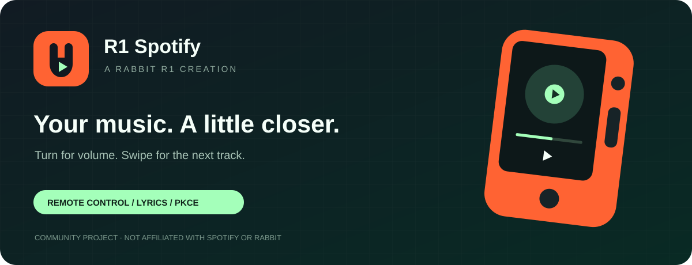
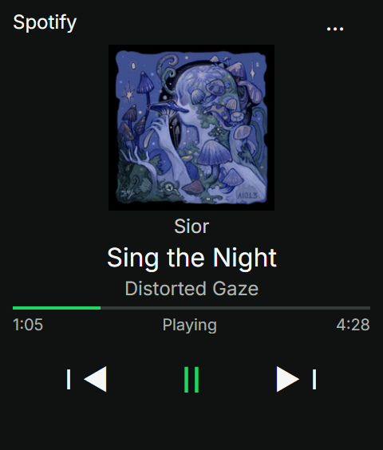
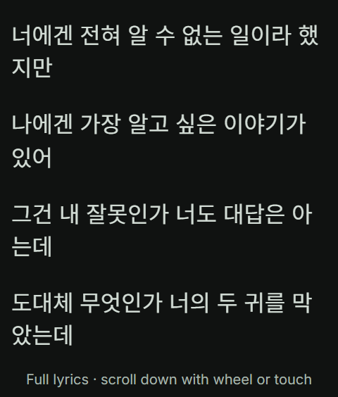
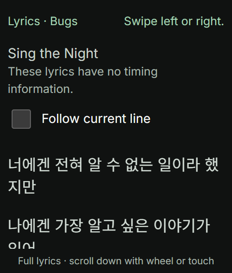
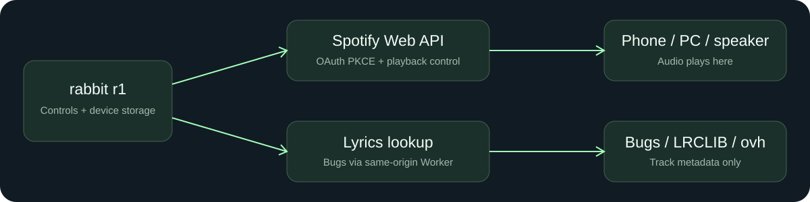

<p align="center"></p>

<p align="center"><strong>English</strong> · <a href="README.ko.md">한국어</a></p>



<p align="center">   <a href="LICENSE"></a></p>

# R1 Spotify

**An open-source Spotify remote for rabbit r1. Build it, host it, make it yours.**

See the artwork, track, artist, album and playback progress. Swipe to skip, press the side button to pause, and turn the wheel for volume. The Creation runs on r1 without a companion PC; audio continues on the active phone, computer or speaker signed in to the same Spotify account.

[Get started](#get-started) · [Controls](#controls) · [Voice requests](#voice-requests) · [Self-host](#self-host) · [Privacy](#privacy-and-authentication) · [Troubleshooting](#troubleshooting) · [Verification](#verification)

> Open-source under MIT. Open the hosted app, enter your own Spotify Client ID once, then sign in. Self-hosting is optional for developers. Playback control requires Spotify Premium, app account access and an active playback device.

## Built for a small screen

| Capability | What you get |
| --- | --- |
| Hardware-first control | Side-button play/pause; wheel volume in 5% steps; artwork swipe for previous/next |
| Multilingual voice requests | On-device Whisper recognition → local request parsing → Spotify search; no AI API key or running companion PC; r1 inference still needs testing |
| Focused lyrics | Tap artwork to open lyrics; scroll with the wheel; follow the current line when timestamps exist |
| Multiple lyric sources | Bugs first, then LRCLIB exact/search and lyrics.ovh fallback |
| Session recovery | PKCE login, token refresh and on-device session restoration |
| Resilient playback state | Approximately 3-second foreground polling, interpolated progress and rate-limit backoff |
| Compact layout | Short viewport handling, bottom spacing and device diagnostics |

## Preview

<table><tr><th>Now playing</th><th>Lyrics focus</th><th>Follow controls</th></tr><tr><td></td><td></td><td></td></tr></table>

English UI previews feature **Sing the Night** by **Sior**, from **Distorted Gaze** (metadata translated for the preview). Track information, artwork and original Korean lyrics: [Bugs](https://music.bugs.co.kr/track/32794635). Playback state is mocked. At the song owner’s request, the preview loads all 42 lines returned by Bugs and fills the visible lyrics viewport with actual lyrics; the remaining lines are scrollable. The UI is English and the original Korean lyrics remain untranslated.

## Get started

Use the **hosted app with your own Spotify Client ID**. You do not need a server deployment or an invitation to the repository owner's Spotify app. After setup, My device restores your connection; Shared device signs in for this page only.

### What you need

- A rabbit r1 with access to add a Creation
- Your own Spotify Premium account
- A phone or computer for Spotify developer setup
- A phone, computer or speaker playing Spotify on that same account

### 1. Add the app to Creation

Register the [hosted R1 Spotify URL](https://r1-spotify-player-jjs1124.plutoparty.chatgpt.site/) as your rabbit Creation launch URL. The QR below points to that same URL; it does not issue a Client ID or connect your account.

<p align="center"></p>

The [Creation configuration](docs/install-creation.json) also contains the launch information. Users do not need to download source or deploy a server.

### 2. Create your own Spotify developer app

On a phone or computer, open [Spotify Developer Dashboard](https://developer.spotify.com/dashboard). Sign in with **the Premium account you will use**, then select **Create app**.

| Field | Example |
| --- | --- |
| App name | My R1 Spotify |
| App description | Personal Spotify remote for my rabbit r1 |
| Website (if requested) | `https://r1-spotify-player-jjs1124.plutoparty.chatgpt.site/` |
| API/SDK selection (if shown) | Web API |
| Redirect URI | The exact address in step 3 below |

Review the developer terms and create the app. Dashboard labels and placement may change; see [Spotify's official app setup guide](https://developer.spotify.com/documentation/web-api/concepts/apps).

### 3. Register the Redirect URI

In your Spotify app, open **Settings → Redirect URIs**, add the following address, and **Save**. If you entered it while creating the app, check the saved value.

```text
https://r1-spotify-player-jjs1124.plutoparty.chatgpt.site/
```

**Match the trailing `/` too.** R1 Spotify's connection screen shows its current address with a copy button. For another deployment, register the address shown there. Do not use the GitHub repository URL as your Redirect URI.

### 4. Send your Client ID from your phone and log in

1. On r1, choose **Set up with phone · QR / code**.
2. Scan the QR **with your phone camera**. The phone setup page opens with the code filled in.
3. On your phone or computer, copy the 32-character **Client ID** from your own Spotify app's **Settings**, paste it into the setup page, and select **Send to r1**.
4. Compare the last 8 characters on both screens, then choose **Use this Client ID** on r1.
5. Choose **My device** or **Shared device**, then select **Save Client ID and log in** on r1. Sign in and grant Spotify access there.
6. Play music on another device using the same Spotify account.

**Cannot scan?** Open the [phone setup page](https://r1-spotify-player-jjs1124.plutoparty.chatgpt.site/pair.html) on your phone/PC and enter the 8-character code shown on r1. Codes expire after 10 minutes. Select **Create a new code** if expired, already used, or sent by the wrong person. Direct Client ID entry remains available.

**No Client Secret is needed or accepted.** The QR contains only a temporary connection code. It carries no Client ID or Spotify login token. The relay sends only your public Client ID; Spotify login stays on r1. Applying a received ID does not change an existing connection until you explicitly log in.

### Choose My device or Shared device

Choose a login retention mode above the Client ID field.

| Choice | Credential storage | When reopened |
| --- | --- | --- |
| My device · keep me signed in | rabbit secure storage and IndexedDB | Restores the saved login |
| Shared device · this visit only | Tokens remain in the current page's memory only | Login required after reload or reopening |

Changing modes disconnects and removes saved tokens. Shared-mode OAuth preparation is kept only in the same tab's sessionStorage and cleared after completion. A device that returns OAuth in a completely new WebView may therefore be unable to finish shared-mode login. The non-secret mode preference is retained. Disconnect when finished; sign out on Spotify too if you need to end Spotify's own browser login. This app cannot delete Spotify website cookies.

### If connection fails

| Symptom | Action |
| --- | --- |
| Invalid Client ID | Use the 32-character Client ID from Settings, not the Client Secret. |
| INVALID_CLIENT / redirect error | Check your app's Redirect URI against the launch app's displayed address, including the trailing slash. |
| 403 / playback permission denied after login | Check account access in **your own app's** Users Management; if needed, add your name and Spotify email with Add new user. Also check Premium and device restrictions. |
| Signed in but no track appears | Start playback on a phone, computer or speaker using the same account. |
| Previously used the shared ID | Only implicit legacy defaults are disconnected. Explicitly configured IDs are retained, including the original app owner’s ID. Use the saved-ID recovery button to fill a previous ID, then log in. |

Spotify development-mode user and request limits apply to **each user's own Spotify app**. Users of this project do not share a single Client ID. App creation eligibility and account requirements remain subject to Spotify policy. [Official quota policy](https://developer.spotify.com/documentation/web-api/concepts/quota-modes)

## Controls

| Screen | Input | Action |
| --- | --- | --- |
| Player | Swipe artwork left / right | Next / previous track |
| Player | Press r1 side button once | Play / pause |
| Player / Lyrics | Once voice is ready, hold r1 side button, speak, then release | Record and search Spotify by artist and song; automatically play a unique exact match or choose a result |
| Player | Voice search button | View readiness or retry microphone permission with one tap; preparation does not require holding a button |
| Player | Wheel up / down | Volume +5% / −5%, within 0–100%, if supported by the active device |
| Player | Tap artwork | Open lyrics |
| Lyrics | Wheel or touch scroll | Explore freely; turns off automatic following |
| Lyrics | Tap, or press Enter | Reveal controls; another tap hides them; auto-hide after 3 seconds |
| Lyrics | Enable “현재 가사 따라가기” | Jump to and follow the current timed line |
| Lyrics | Swipe left / right, or Escape | Return to player without skipping tracks |
| Menu | Three dots | Connection settings, disconnect, help and device diagnostics |

Tapping lyrics preserves follow mode. Checkbox interaction restarts the controls timer. Plain lyrics have no timed follow mode. Vertical drags, short touches and cancelled gestures do not close lyrics. The app follows the WebView language for Korean/English UI; original lyrics are not translated.

## Voice requests

### Test on r1 without an API key

The r32 default runs **Whisper on the device**, replacing the browser speech service that timed out on the reported r1. No AI API key or running companion PC is needed. On first use, allow about **65 MB of public model/runtime downloads** over the internet. The loaded model stays in memory across successful requests, and model files use the browser cache when available. They are not downloaded on every hold. Reloading still requires model initialization; a cleared or evicted cache, a changed model, or a new WebView storage context can require another download. This is browser-based local inference, not access to Rabbit's native speech recognizer.

Open the [rabbit voice diagnostic page](https://r1-spotify-player-jjs1124.plutoparty.chatgpt.site/rabbit-test.html?v=20261025-r26-test) from **Test rabbit voice without an API key** in the Creation's connection settings. It needs **no Spotify login**. Check the `20261025-r26-test` label, then:

1. Keep **Whisper · 기기에서 인식** selected and press **음성 인식 준비**. Wait for the ready indicator.
2. Hold the on-screen button or the r1 side button, speak a short 3–5 second request, and release. If permission is requested, allow it and hold again.
3. Wait for the transcript. **자동 감지 · Whisper** identifies the language; Korean, English or Japanese can also be selected explicitly.
4. Check the words, then press **③ 인식 문장 분석** to test Rabbit's artist/title extraction. Copy the report if a stage fails.

The diagnostic keeps transcription and Rabbit analysis separate. Audio is processed locally; only the explicit analysis button sends the transcript to Rabbit. **① 래빗 AI 연결 확인** independently tests a fixed example and does not prove speech recognition works. Microphone-only mode discards the recording after measuring bytes. Optional browser speech mode remains for comparison and may use the browser vendor's service; its browser-default language option is not automatic detection. Copied reports exclude spoken text, raw AI replies and credentials.

The user reported Rabbit AI connection success, a Web Speech timeout and a 20,262-byte microphone recording. A byte count proves recording output, not intelligible speech. Actual-model tests in desktop Edge succeeded for English and Korean language detection, but the Korean song name was transcribed incorrectly. The user subsequently reported slow r1 inference and “아이유의 밤편지 틀어줘” becoming “IU의 편벤지트로저”. r26 removes manual preparation and duplicate computation; **updated r1 latency, accuracy and complete playback still need a device trial.** See the [verification record](docs/local-voice-verification.md).

### Request songs in the player

The player button, panel and settings call this feature **Find a song**. The button keeps that name; microphone connection, listening, transcription, Spotify search and playback confirmation appear as separate statuses inside the panel.

1. Sign in to Spotify and start playback on another device with the same account. On connected app startup, the model, microphone and recorder prepare automatically before waiting for Spotify playback data. **Leave the button released while the microphone prepares.** Allow the browser's microphone permission prompt if shown. If automatic access is rejected, use the on-screen permission/retry control once; no sustained press is required.
2. **Once the microphone is ready, hold the side button, speak, and release.** Recording is available even while the recognition model is still preparing. The prepared recorder resumes, and the red indicator/timer confirms recording. After release, recognition waits for any remaining model setup before searching; there is no live transcript while holding. Pressing before microphone preparation finishes does not queue a later recording: release the button, let microphone setup finish, then make a new press. The on-screen recording button follows the same sequence.
3. Local Whisper detects the language and transcribes. Explicit patterns such as ‘play title by artist’ are parsed immediately; other phrasing becomes a conservative Spotify text query, with obvious play-command words removed. Rabbit AI is not called by the player. Spotify plays a unique exact title-and-artist match. Unstructured text searches, uncertain parsing and artist-catalog recovery require choosing a candidate.

r30 prepares the microphone and a paused recorder before the first hold. Idle tracks stay enabled to keep the microphone device ready, while the recorder is paused; initialization may retain a short encoded silence/header, never an idle ambient recording. Each completed or cancelled hold prepares the next recorder automatically using the same healthy microphone. Closing the voice panel preserves readiness. Hiding/leaving the page, disconnecting Spotify, or changing session mode releases capture and invalidates pending permission results. Returning to the foreground prepares again automatically. The browser may retain its microphone indicator while the live connection is held. The separate diagnostic page keeps its explicit test workflow.

r30 moves microphone permission and recorder startup out of the hold gesture. Actual recorder resume controls the recording indicator; model loading never claims the microphone is recording. Preparation failures show a tap-to-retry action instead of asking the user to keep holding. Screen wake lock is requested during automatic voice preparation and while the voice panel is open, where supported. It cannot override Rabbit firmware sleep or guarantee the app remains open. A brief vibration on recording start is optional and browser-dependent. First model download/initialization and post-release recognition still take time; the change removes preparation work from the user's hold.

r32 refreshes the Spotify playback device when a candidate is selected or an exact match is played, then verifies the requested track and playing state on that device. Receiving a successful playback request alone does not complete the flow. If playback cannot be confirmed, the list remains with a reason so the same song can be retried without speaking again. No active device means opening Spotify on the intended phone, computer or speaker first. Playback continues on that Spotify device, not through the r1 Creation itself.

r35 plays a selected song directly from its album on the current Spotify device. The user confirmed that r34's album action played the song on their phone after the ordinary track-list request produced no playback information. Candidate selection and exact-match playback now use that working route immediately, without a failed request and a second button press. Following album tracks may continue; the voice screen explains this before playback. Spotify's response must still confirm the requested song, playing state and current target device. Unconfirmed playback retains the candidates and the specific state message introduced in r34. The underlying Spotify-side reason remains unverified.

r31 also preserves model loading or the initialized worker when an in-progress player request is cancelled. The old result is discarded and cannot search or play a song. A new request waits briefly for cancelled computation to finish; if it remains busy for three seconds while a new request is waiting, the worker is replaced and prepared again. Crashes, original timeouts and diagnostic hard cancellation still release the worker. A page reload still needs model initialization, even when its files are cached. The UI distinguishes microphone setup, loading the current model file, recognizer initialization and post-release transcription; displayed time is elapsed time, not an ETA.

r31 retains r26’s shared audio encoder result for language detection and transcription. If a garbled title cannot be found, artist-catalog candidates provide recovery. This does **not correct the raw recognition text or guarantee accuracy**; recovered candidates always wait for a selection.

Try **“아이유의 밤편지 틀어줘”** or **“Play Yesterday by The Beatles.”** The model is instructed to transcribe rather than translate. Small models can mishear names, short utterances and mixed-language requests; inspect the displayed text and candidates. Recording ends on release. The former 15-second limit is replaced by a 60-second/2 MiB safety ceiling for a stuck button. Cancel, hide/page exit, screen changes or disconnect invalidate pending work.

Spotify Client ID, login, Premium and an active playback device are still required for playback. No Gemini secret or server voice allowlist is required by this default flow. If an older login lacks search permission, reconnect once to grant `user-read-private`; refreshing a token cannot add permissions. See [Spotify's scopes](https://developer.spotify.com/documentation/web-api/concepts/scopes). The [physical-button events](https://github.com/rabbit-hmi-oss/creations-sdk/blob/main/plugin-demo/reference/creation-triggers.md#hardware-button-events) require the open Creation; on-screen voice capture does not require Rabbit's text bridge. Music continues on the Spotify playback device.

| Error code | Action |
| --- | --- |
| `model_load_failed` / `local_model_timeout` | Check connectivity and press preparation again; first use downloads model/runtime files |
| `local_worker_failed` | Prepare again; the WebView may have stopped the worker |
| `local_transcription_timeout` | Retry with a 3–5 second phrase; selecting Korean explicitly skips language detection in diagnostics |
| `rabbit_no_response` / `rabbit_unmatched_response` | Share the diagnostic report; text analysis did not produce a matching response |

Implementation: [Transformers.js](https://huggingface.co/docs/transformers.js/v3.8.1/en/pipelines) **3.8.1**, multilingual `Xenova/whisper-tiny` q8 at revision `5332fcc35e32a33b86612b9a57a89be7906102b1`, single-thread WASM in a Web Worker. The app explicitly performs language classification because this library version otherwise defaults to English. [ONNX Runtime lists Android Chrome/Edge WASM support](https://onnxruntime.ai/docs/get-started/with-javascript/web.html#supported-versions); this does not certify the r1 WebView.

## How it works



The browser calls Spotify directly for authentication, search and playback control. A same-origin Worker serves the UI and the Bugs lyrics endpoint. Default voice requests use local Whisper and local request parsing, then search Spotify directly. The retained Gemini server endpoint is an optional developer integration and is not called by the default player. LRCLIB and lyrics.ovh are browser fallbacks. This project controls an existing Spotify player; it does not stream audio to r1.

### Lyrics lookup

Bugs matching checks title, artist aliases and a duration difference of at most 2 seconds, prefers the same album, and examines at most three deduplicated candidates. Version names are retained; English titles are not automatically translated into Korean. Bugs returns plain lyrics. If unavailable, the client tries LRCLIB exact lookup and search, then lyrics.ovh. Tap the lyrics view to see the actual provider.

Bugs server lookup has a 20-second budget; the browser waits up to 25 seconds. Successful responses can be reused by the device for 5 minutes. Provider availability, coverage and public page structure may change.

## Hosting

The public app remains on its existing Sites hosting. It is not being migrated to Cloudflare. The self-hosting instructions below are optional for developers operating an independent fork.

## Self-host

Optional for developers and independent operators. Prepare Git, Node.js 24 with npm, an HTTPS hosting account and your own Spotify Web API app.

```powershell
git clone https://github.com/plutoparty1/Rabbit_R1.git
cd Rabbit_R1/r1-spotify
```

After deployment, register your exact HTTPS Redirect URI in Spotify Dashboard and enter your Client ID in connection settings. Update the [installation template](docs/install-creation.example.json) and rabbit Creation launch URL to your own deployment.


The frontend and server build without application package installation. `npx` downloads Wrangler when needed. Run these commands from `r1-spotify`:

```powershell
node scripts/build.mjs
npx wrangler login
npx wrangler deploy --config wrangler.jsonc
```

The [Wrangler example](wrangler.jsonc) uses the generated `dist/server/index.js` entry point and runs the build before deployment. Change `name` if desired and deploy through your own Cloudflare account. Register the HTTPS URL printed by the CLI in Spotify and rabbit Creation. See the [Cloudflare configuration reference](https://developers.cloudflare.com/workers/wrangler/configuration/) for configuration details.

To preview the frontend and server locally:

```powershell
node scripts/build.mjs
npx wrangler dev --config wrangler.jsonc --port 8791
```

The local address is for development. Use your deployed HTTPS URL for r1 installation and actual Spotify login. Rebuild after frontend edits. The build bundles the existing `dist` UI and server modules into the Worker. Other hosting must support the same module Worker interface and `/api/lyrics/bugs`. Preserve the voice page/worker Content Security Policy: WASM compilation, jsDelivr runtime downloads and Hugging Face model downloads must be allowed.

### Optional legacy Gemini backend — developers only

The server speech module remains for developers who deliberately integrate it in a fork. **The r27 default player uses local Whisper and does not call `/api/voice/config` or `/api/voice/search`. Setting these secrets alone does not switch the player back to Gemini.** No settings below are needed for the default flow. A custom caller must use the authenticated `POST /api/voice/search` contract and disclose the audio upload. Keep the existing Sites hosting when updating the public instance; Wrangler instructions apply only to an independently hosted fork.

| Server setting | Purpose |
| --- | --- |
| `GEMINI_API_KEY` | Required server secret for the Gemini API; never include it in frontend files, a Git commit or a public configuration file |
| `VOICE_ALLOWED_SPOTIFY_USERS` | Required comma-separated Spotify **user IDs** from `GET https://api.spotify.com/v1/me`: prefer immutable `account_id`, or use `id`; these are neither emails nor Client IDs |
| `VOICE_MODEL` | Optional Gemini model override; defaults to `gemini-3.8-flash`. Use a model available to your project that supports audio input and structured JSON output |

For an independent Wrangler deployment, set the API key with `npx wrangler secret put GEMINI_API_KEY --config wrangler.jsonc`. Add `VOICE_ALLOWED_SPOTIFY_USERS` and an optional `VOICE_MODEL` to the deployment's environment variables. For local development, use an untracked `.dev.vars` file with those same names. Do not commit real keys or user IDs.

This optional endpoint accepts the current Spotify access token in the Authorization header, verifies it against Spotify's `/v1/me`, and checks the user ID against the server allowlist before calling Gemini. It does not accept anonymous requests. `GET /api/voice/config` reports whether its required server settings are present; it does not test provider credentials. Missing Gemini configuration does not disable the default local voice flow.

Each Spotify identity is limited to 6 requests per minute, 60 per hour, and one active request **per warm Worker isolate**. These in-memory limits are not global quotas across instances or restarts. Configure provider spending/usage limits or a shared gateway quota for broader deployments. Spotify verification has an 8-second timeout and Gemini a 25-second timeout; paid inference is not automatically retried. The endpoint accepts at most 2 MiB of decoded audio in a 3 MiB JSON request. Audio formats include WebM, Ogg, WAV, MP3/MPEG, AAC, FLAC, M4A and Opus; MP4 audio is normalized to M4A for the provider.

The implementation uses Gemini's [audio input](https://ai.google.dev/gemini-api/docs/audio) and [generateContent API](https://ai.google.dev/api/generate-content); check [model availability](https://ai.google.dev/gemini-api/docs/models/gemini-3.8-flash) for your project before deployment.

### Sharing the project

- **Help others use the app:** Share the hosted app URL or QR and the quick-start instructions.
- **Share your modifications:** Publish your fork and retain the MIT copyright and license notice.
- **Operate a shared instance:** The operator manages hosting; each user registers and uses their own Spotify app as described above.

Spotify development-mode limits apply to **each Spotify app**, not to how many people may fork or download the source. As checked on 2026-10-18, the app owner needs Premium and each app supports up to five authenticated, allowlisted users. Serving a larger audience with one Client ID requires separate extended quota approval. Check the [official Spotify policy](https://developer.spotify.com/documentation/web-api/concepts/quota-modes) for current conditions.

## Privacy and authentication

The hosted app controls playback using each user's own Client ID and Spotify login, without sharing the repository owner's Spotify account. On 2026-10-18, the old server-side lyrics bridge URL and authentication key were removed and the app redeployed. Public lyric providers supply fallback lyrics without a personal Spotify session. Hosting remains under the operator's Sites account. Disconnect before another person uses the same device/browser.

| Data | Handling |
| --- | --- |
| Access and refresh tokens | My device: native secure storage plus IndexedDB; Shared device: page memory only; not localStorage. Default voice requests do not send Spotify tokens to Rabbit or the voice server. Only a custom legacy backend caller sends an access token for Spotify identity verification. Refresh tokens are sent only to Spotify |
| Pending OAuth transaction | My device: localStorage; Shared device: same-tab sessionStorage; 10-minute expiry, one-time state and PKCE verifier; removed on completion, disconnect or expiry checks |
| Client ID | Public identifier only; localStorage for My device, same-tab sessionStorage for Shared device |
| Phone setup relay | Public Client ID, receiver-proof hash and expiry temporarily in Sites storage; no Spotify credentials. Received/cancelled sessions are deleted. Expired sessions cannot be used and abandoned records are pruned during new-session creation. |
| Bugs request | Track title, artist, album and duration only; no Spotify token |
| Other lyrics requests | Track metadata sent to the selected provider; no Spotify credentials |
| Default voice request | Audio is decoded and transcribed on the device, without an audio upload. The extracted artist/title or a cleaned text query is sent to Spotify. No Rabbit AI request is made by the player. The app does not persist or log recordings/transcripts |
| Model/runtime downloads | Public files from jsDelivr and Hugging Face; no AI API key. Browser caching may retain model files; it does not store recordings |
| Optional legacy Gemini caller | If a developer explicitly integrates it, audio goes to the site server and Gemini; Spotify credentials do not go to Gemini. Provider processing/retention follows the operator's service settings and terms |

IndexedDB is browser storage, not a hardware-encrypted vault. The backup remains because a native storage success response may not guarantee persistence. Secure storage initialization is retried for a bounded time; persistent storage must be confirmed before the app reports that login will survive reopening.

Disconnect removes saved credentials and records a logout marker to block restoration from stale native storage. Clearing browser data, blocked storage or revoked Spotify permission may require login again. Disconnect before handing a shared device/profile to another person. OAuth callback codes are removed from the address; do not put tokens, credentials or authorization codes in issues, screenshots, QR codes or logs.

## Troubleshooting

| Symptom | Check or action |
| --- | --- |
| An old link asks for ChatGPT login | Use your own Worker deployment URL registered in your Creation |
| OAuth redirect error | Match the exact HTTPS URI, including trailing slash, in the Dashboard |
| Login succeeds; controls return 403 | Check the allowlist, Premium account and playback-device restrictions |
| No current track | Start Spotify playback on another device with the same account |
| Volume does not change | Inspect device diagnostics; remote volume support depends on the active device, not merely its operating system |
| Lyrics do not follow | Check whether the provider returned timestamps, then enable the follow checkbox |
| Lyrics are missing | Check connectivity and provider availability; mismatched title/version/duration can prevent a match |
| Login is lost after reopening | Inspect storage diagnostics; reconnect if storage was cleared, blocked or authorization revoked |
| Rate limited / offline | The app respects Retry-After and labels last-known data; avoid repeated manual commands |
| Old or cropped UI after returning | Check the displayed version and viewport in diagnostics; compare deployment assets with source |
| Voice model not ready / download failed | Preparation starts automatically in the player; retry after a failure and check internet access. First download/reloading can still require preparation time |
| Recognition times out on r1 | Use local Whisper, try a short 3–5 second phrase and share the stage/error code; r1 local inference performance is not yet established |
| Rabbit AI unavailable | The player no longer depends on Rabbit AI. Only the separate diagnostic text-analysis test uses that bridge |
| Existing login needs search permission | Reconnect and sign in once to grant `user-read-private`; token refresh alone does not add this permission |
| Microphone denied or unsupported | Allow microphone access and use an HTTPS URL; check the current r1 WebView's recording support |
| Voice request finds the wrong song or multiple songs | Say both artist and title clearly, then inspect the candidate list; proper names and language detection can be misrecognized |
| Voice recognized but playback fails | Start Spotify on another device with the same account; check Premium, device restrictions and Spotify access |

Foreground polling pauses while the app is hidden. Resume signals are coalesced, viewport size is rechecked, stale responses and queued volume input are invalidated, and displayed lyrics/free-scroll position are retained where possible. Failed skip commands are not blindly retried.

## Full lyrics and scrolling

The live view renders every returned paragraph rather than a fixed excerpt. Use the wheel or touch to scroll; the bottom hint changes to End of lyrics at the final paragraph. Provider line endings are normalized. Plain lyrics have no synchronized following; missing provider content cannot be reconstructed by the app. A static preview shows only its visible viewport. The browser regression test checks all 120 synthetic paragraphs and the final scroll position.

## Development

```text
r1-spotify/
├── dist/                 HTML, CSS and browser ES modules (frontend source)
├── server/               Worker entry, Bugs lookup and optional voice service
├── scripts/build.mjs     Embeds UI and generates dist/server/
├── tests/                Node tests and Playwright callback scenarios
├── docs/                 Installation, screenshots, evidence and SVG assets
├── wrangler.jsonc Deployment configuration example
├── LICENSE               MIT license for r1-spotify
└── DESIGN.md             UI design notes
```

### Verification

```powershell
node scripts/build.mjs
node --test tests/*.test.mjs
node --check dist/app.mjs
node --check dist/spotify.mjs
```

Node tests cover core logic, OAuth, Spotify, lyric matching, Bugs, voice recording/selection and Worker responses. The `tests/*-check.js` files are Playwright callback functions, not standalone Node test commands. Serve `dist` at `http://127.0.0.1:8791/`, then invoke each callback with a Playwright Page. Most scenarios mock Spotify and lyric responses; `bugs-browser-check.js` uses live Bugs lookup with mocked playback. No lint/typecheck configuration is included.

| Evidence | Scope and limits |
| --- | --- |
| Node suite | Reproducible automated logic checks; does not prove hardware behavior |
| Recorded browser scenarios | 240×282 and smaller viewports, gestures, wheel, follow controls, authentication recovery, volume and resume |
| r22 voice browser scenarios | English/Korean Edge at 240×282 and 240×240: automatic playback, candidate selection, cancellation, errors and unconfigured service; microphone, recognition and Spotify responses are mocked |
| r25 actual-model browser test | Desktop Edge WASM: Korean/English language detection and transcription; Korean song name incorrect. No r1 speed/accuracy or real Spotify playback claim. [Record](docs/local-voice-verification.md) |
| User's r1 diagnostic report | Rabbit AI connection succeeded, browser speech timed out, microphone produced 20,262 bytes; r25 local inference ran slowly and misrecognized the Korean song request |
| Historical r6 user report | Login retention, wheel input, manual/follow lyrics and visible playback buttons |
| Pending | Latest WebView end-to-end behavior, r7 tap controls on hardware, full multi-user sharing flow and device-specific volume; r1 recording decode, local Whisper speed/accuracy and voice-triggered Spotify playback |

The source UI identifies itself as `20261025-r35`. Check your deployed version in device diagnostics. The [local voice verification record](docs/local-voice-verification.md) distinguishes user reports, actual-model desktop checks and pending r1 tests. [verification.json](docs/verification.json) is historical evidence dated 2026-10-08, not a new certification. Detailed Korean implementation and test notes are preserved in the [original documentation archive](docs/archive/README.2026-10-18.ko.md).

## License

Code and original documentation/SVG assets in `r1-spotify/` are available under the [MIT license](LICENSE). You may use, modify, copy, redistribute and use them commercially while retaining the copyright and license notice. This license does not apply to sibling projects. Third-party services, trademarks, album art and lyrics remain subject to their owners' rights and are not covered by this MIT grant.

## Typography

Latin text uses [Inter](https://rsms.me/inter/); Korean uses [Noto Sans KR](https://fonts.google.com/noto/specimen/Noto+Sans+KR). Both are distributed under the SIL Open Font License, with [license notices](dist/fonts) included. Font files are served from the app itself, without runtime requests to Google Fonts. These fonts apply to the app and screenshots; GitHub controls the README body font.

## Contributing

1. Fork the repository and create a working branch.
2. Edit the frontend in `dist/` and server code in `server/`.
3. Run the build and relevant tests, and verify the changed behavior.
4. Update English and Korean docs together; open a pull request describing the change and validation.

## Support and references

Report problems in [GitHub Issues](https://github.com/plutoparty1/Rabbit_R1/issues) with the displayed version, device/WebView, viewport, playback device, reproduction steps and redacted diagnostics. Keep documentation changes aligned across English and Korean; label mock captures and separate hardware reports from automated checks.

- [Spotify playback state](https://developer.spotify.com/documentation/web-api/reference/get-information-about-the-users-current-playback), [volume control](https://developer.spotify.com/documentation/web-api/reference/set-volume-for-users-playback) and [PKCE](https://developer.spotify.com/documentation/web-api/tutorials/code-pkce-flow)
- [rabbit hardware events and secure storage](https://github.com/rabbit-hmi-oss/creations-sdk/blob/main/plugin-demo/reference/creation-triggers.md)
- [LRCLIB](https://lrclib.net/docs) and [lyrics.ovh](https://github.com/NTag/lyrics.ovh#api)

Original SVG project mark, hero and architecture assets live in [docs/assets](docs/assets). The illustrated device is a concept graphic. Spotify and rabbit names belong to their respective owners; this community project is not affiliated with or endorsed by either company. Visual hierarchy was informed by [jev-gate](https://github.com/MongLong0214/jev-gate); its assets were not copied.

### Phone setup hosting

The existing Sites host provides the relay through an R2 binding named `PAIRING`; no new hosting account is required for users. The host remains unchanged. Eight-character random codes expire after 10 minutes, submissions are one-time, and only the originating device can retrieve a Client ID using its separate 256-bit receiver secret. Same-origin checks, bounded request bodies and per-IP rate limits protect relay endpoints. The QR renderer is vendored locally under MIT; no external QR service receives the URL.

For an optional self-hosted deployment, bind an R2 bucket as `PAIRING` in your Worker configuration. The included Wrangler example declares this binding; create a bucket and replace the example bucket name. Without storage, direct entry and login still work, and phone setup reports that it is unavailable. [QR library license](docs/licenses/qrcode-generator-LICENSE.txt).
